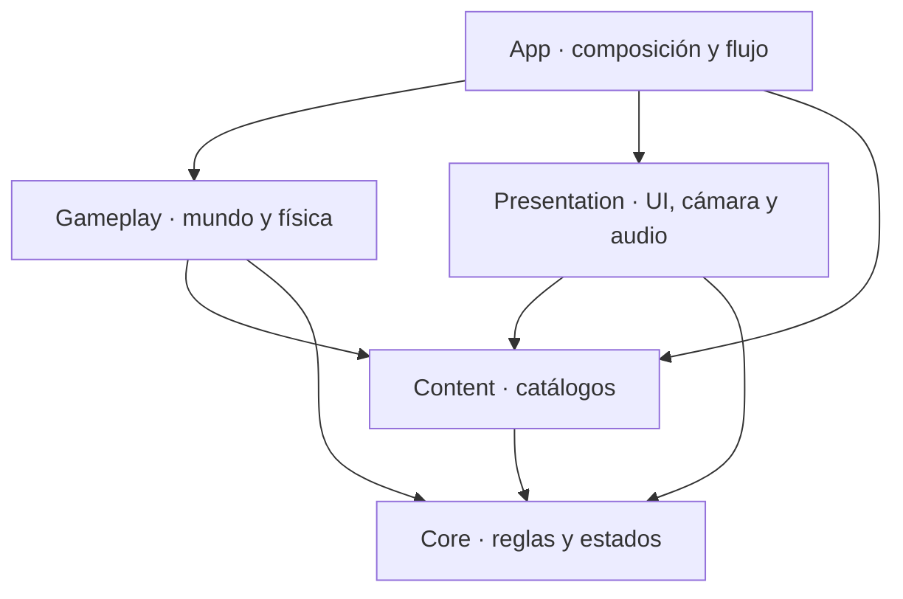

# Luckbound — Preproducción y plan completo de desarrollo

**Versión del documento:** 3.52 — 30 de octubre de 2026.

**Actualización 3.36:** se registra el contrato F09.ENCOUNTERS consultado con GPT-6.1 Sol (`xhigh`). El dictamen `Conditional` y sus límites están en [el informe de arquitectura](agent_staging/sol-f09-encounters-architecture-20261025/REPORT.md), SHA-256 `92a7c0f69af6e4a9d6665c9ef6d56f557ef5bb67860475791720a982bf22ab9a`. Toda revisión humana o nueva decisión de diseño continúa delegada a Sol; su dictamen no reemplaza aceptación técnica.

**Actualización 3.37:** se fija el siguiente corte F09.ENCOUNTERS.RUNTIME.TECH según la consulta Sol `Conditional` del 26 de octubre. Informe y contrato detallado: [sol-f09-runtime-next-architecture](agent_staging/sol-f09-runtime-next-architecture-20261026/REPORT.md), SHA-256 `cd6b350313bb65540dc04a2d5593270ec392d98141a252bbb2b4257fb10cb74b`. Es un runtime técnico aislado, sin provider productivo, resolver, pagos, avance de sala ni aceptación F09/F10.

**Actualización 3.38:** tras aceptar Sol estáticamente la fixture RUNTIME.TECH, el siguiente contrato consultado es `F09.ENCOUNTERS.READINESS.SOURCE`, dirección `Conditional` en [su informe](agent_staging/sol-f09-next-integration-architecture-r1-20261026/REPORT.md), SHA-256 `4f538317da23f547e0270ab42107f02aad49d466d76306a5f27a6c4771ecc9fa`. Registra hechos reales de bind, publicación, activación y leases para producir snapshots; no crea un plan productivo ni conecta victoria, recompensas o avance. Los hooks de composición son parte necesaria del mismo paquete y siguen bajo ownership del coordinador.

**Actualización 3.39:** Fran reafirma que **todas** las comprobaciones que requieran criterio humano y cada nueva decisión de diseño se delegan al revisor GPT-6.1 Sol (`xhigh`), incluidas las que surjan fuera de los cinco hitos de la tabla siguiente. Sol recibe el artefacto exacto y emite `Accepted`, `Conditional`, `Rejected` o `Not reviewable` con límites explícitos. No se pide a Fran una comprobación humana rutinaria ni se convierte falta de percepción/silencio en aprobación; los gates técnicos siguen siendo independientes. Para `READINESS.SOURCE`, Sol aceptó la integración a través de una sola operación concreta del owner; dictamen y límites en [su informe](agent_staging/sol-f09-room-services-design-review-20261026/REPORT.md), SHA-256 `e020c28560d1ed4d7191892dd6a2285ec0b03b40b2ae6f067120a6933fc59232`.

**Actualización 3.40:** Sol aceptó capturar el gate global `ApplicationBootstrapper.HasPendingSessionMutation` como campo read-only derivado `hasPendingSessionMutation` de `ExpeditionReadinessAuthorityCapture`, propagado al snapshot. Si está activo, no autoriza arm/drain; no se adquiere/libera ni cachea el gate. Los indicadores separados de publicación y avance se conservan. [Dictamen y límites](agent_staging/sol-f09-pending-mutation-design-review-20261026/REPORT.md), SHA-256 `70dd8ebd5a415e5a9860875e53d2944843207af2fcd433f1d516f998664c2c6d`.

**Actualización 3.41:** la vigencia del publication witness requiere igualdad exacta entre su revisión y la revisión App actual y coincidencia íntegra del estado confirmado JSON; una revisión posterior necesita una constancia nueva, aunque el save sea igual. La sesión restaurada debe conservar igualdad exacta con el checkpoint que pasó por el binder. [Dictamen Sol y límites](agent_staging/sol-f09-publication-witness-currentness-20261026/REPORT.md), SHA-256 `c5a251cfd0008a783b97f60d9b20c0deeb759466962171548132c009a5cbe17e`.

**Actualización 3.42:** se implementó F09.ENCOUNTERS.READINESS.SOURCE dentro del ownership ya fijado: registro por sesión/scope, captura de readiness desde autoridades reales, binds/publicaciones comprobadas y gates de transición/lease. El compile offline comprobó 358/358 fuentes y 16/16 assemblies; el detalle y sus manifiestos están en [PROGRESS.md](PROGRESS.md). Las seis pruebas sintéticas compilan pero no se ejecutaron. Sol revisa los hashes exactos del código integrado; sin Unity ni prefabs productivos no se habilita Runtime.Prepare ni se considera aceptado F09/F10. Todas las comprobaciones humanas y nuevas decisiones de diseño siguen delegadas a Sol xhigh.

**Actualización 3.43:** Sol revisó los seis hashes de READINESS.SOURCE y emitió `Conditional` con F1–F3 P2. El informe identifica el fallback restaurado sin revisión exacta, el replay de publicación con revisión posterior/otra instancia de `ActiveRun` y la ausencia de revalidación del owner activo. La política aprobada permite cerrar readiness temporalmente cuando el componente owner se deshabilita; no dispone la sesión ni crea otra activación. Luna implementa estas correcciones y regresiones; Sol debe revisar el hash corregido. El dictamen no es aceptación Unity ni de F09/F10.

**Actualización 3.44:** Sol `Accepted` el diseño acotado de spawn IDs para el fixture C08: schema 2, `spawnId` ASCII literal, obligatorio y único a nivel de encuentro. La cobertura local corregida también fue aceptada estáticamente; NUnit/Unity siguen sin ejecutarse. La clave local no es aún identidad durable compuesta ni autoridad de muerte/recompensa.

**Actualización 3.45:** Sol fijó condicionalmente la identidad durable de spawn F09 como tuple `(RunId, RouteGenerationVersion, NodeId, RoomInstanceId, EncounterId, LocalSpawnId)` y un codec v1 con framing length-prefix UTF-8 estricto y SHA-256. Se permite implementar el codec puro Core; no se concede permiso productivo sin catálogo autoritativo de encuentros y pin durable del plan por run/nodo. Conserva `room-result.v1` y `encounter-reward.v1`; no añade campos a SaveDocuments ni cambia recompensas. [Contrato Sol y límites](agent_staging/sol-f09-durable-spawn-key-design-20261026/REPORT.md), SHA-256 `f4e2d60d22c899aa641017501c786ce3e74ef6ab3af8507aeea5c7b3a1ac75cf`.

**Actualización 3.46:** Sol fijó condicionalmente el manifest de encuentros schema 1, los digests canónicos, la retención de revisiones y el pin global por run con binding por nodo/checkpoint; el commit inicial y cada transición A→B deben persistirlos en el mismo sobre antes de activar combate. `ContentVersion=7` es una propuesta, no un bump aprobado: exige validar el checksum v6 con DTOs históricos exactos. Un save v6 con expedición activa sin evidencia de pin se conserva y se bloquea para continuación/escrituras que la descarten; nunca se liga al contenido instalado actual. [Contrato Sol y límites](agent_staging/sol-f09-encounter-catalog-pin-design-20261026/REPORT.md), SHA-256 `3c49d050448957b7a4e79a03be0463552f5d4ca64a3ddfa798759d2295a1c4cc`. Luna entregó el codec puro; Sol lo aceptó estáticamente en los hashes exactos, con P3 de cobertura negativa pendiente. El coordinador compiló 360/360 fuentes y 16/16 assemblies, código 0; los tests solo compilaron y no se ejecutaron. [Compile y manifiestos](agent_staging/coordinator-f09-codec-offline-compile-20261026/REPORT.md), SHA-256 `12db930ee14d6cc5cc618dc2072c1ff1fcb231202941241f8d4b079dc3c3e76e`.

**Actualización 3.47:** Luna añadió seis casos negativos al codec, elevando la suite a 23 tests sin cambiar el fuente de producción. Sol aceptó estáticamente el delta exacto y cerró el P3; [revisión R2](agent_staging/sol-f09-spawn-identity-codec-review-r2-20261026/REPORT.md), SHA-256 `0c53169491b58a32baf4fc0af800238e096a139580256cadade12898a6d15c7e`. El coordinador compiló los hashes actuales: 360/360 fuentes, response files exactos, 16/16 assemblies y código 0; 10 avisos CS0618 coinciden con el compile anterior. [Compile R2 y manifiestos](agent_staging/coordinator-f09-codec-offline-compile-r2-20261026/REPORT.md), SHA-256 `54038a52c6107206e022e626725a933d2b8862423924ba9fbfc6afa776290715`. Los tests no se ejecutaron; Unity/PlayMode/build/CI y la autoridad de catálogo/pin siguen sin aceptación.

**Actualización 3.48:** Sol fijó las firmas exactas de la API preproductiva Core→Content: modelos inmutables/factory/tokens/canonicalización en Core; lector JSON estricto y registry inmutable en Content consumen esa API. Dictamen `Conditional`; informe [API Core→Content](agent_staging/sol-f09-catalog-core-content-api-contract-20261026/REPORT.md), SHA-256 `1aace7c5a3b6dcb8dbde913a180383cce06d7eb6e71b30c0d4f230edc8512040`. Luna implementa ahora solo Core en los seis archivos fijados, con datos sintéticos. Content se despachará después de integrar y compilar la API Core exacta. Ningún paquete de este corte añade filas reales, save v7, provider o autoridad productiva.

**Actualización 3.49:** el paquete F09.CATALOG.CORE.TECH quedó estáticamente `Accepted` por GPT-6.1 Sol xhigh en los hashes exactos; los dos P2 de las fixtures están cerrados. La compilación offline r2 cubrió 366/366 fuentes y 16/16 assemblies, código 0, sin avisos nuevos; incluyó cinco fuentes Core y el test corregido. [Dictamen Sol](agent_staging/sol-f09-catalog-core-review-r2-20261026/REPORT.md), SHA-256 `6c8159e1fb0ef04fbe31920a6846d7650cd118bf2d6db67e3320bd4f0b189410`; [compilación y manifiestos](agent_staging/coordinator-f09-catalog-core-offline-compile-r2-20261026/REPORT.md), SHA-256 `bb23a334ca3d537f5d0265f0337bf0801dc3aab386863bac81a2b0cfc16d5d95`. Los tests compilaron pero no se ejecutaron. Ya puede comenzar Content contra la API congelada y con datos sintéticos. No habilita parser productivo, rows, save v7, pin durable, autoridad ni aceptación F09/F10.

**Actualización 3.50:** F09.CATALOG.CONTENT.TECH implementa parser JSON estricto, loader Core y registry exacto inmutable en preproducción. Sol xhigh aceptó estáticamente el código y cerró el P3 con cuatro assertions de claves Unicode equivalentes, shape anidada desconocida/duplicada y escape inválido; [dictamen R2](agent_staging/sol-f09-catalog-content-review-r2-20261026/REPORT.md), SHA-256 `18a7159a163a2b856082cadfa6b51090cdf2bbd06aa73c414c08cb620bff79f6`. Compilación offline r2: 370/370 fuentes, 16/16 assemblies, código 0 y 10 CS0618 idénticos al baseline; [informe y manifiestos](agent_staging/coordinator-f09-catalog-content-offline-compile-r2-20261026/REPORT.md), SHA-256 `2645a2b7737d5186e150f5c060cfa7b5ed6eae51b6d1db20cb930a07c4657d8d`. Tests compilados, no ejecutados. Core/Content no crean filas productivas, retención física, pin durable ni autoridad. Antes de seguir con Save/provider, pedir a Sol xhigh contrato exacto de migración/checksum v6, persistencia y recuperación; no subir ContentVersion v7 por inferencia.

**Actualización 3.51:** Sol aceptó preparar únicamente `F09.SAVE.V6.CHARACTERIZATION.TECH` aditivo, sin wiring a Decode/Repository ni bump de versión. [Contrato Sol](agent_staging/sol-f09-next-catalog-save-pin-contract-20261026/REPORT.md), SHA-256 `99b3becef5c5d83edb9f1d8ad31bb13efd4ff65e9d6e65131e795a30bf0f41a1`, manifiesto `6be9a7e88df91e7fa91729988c1b0d1df65ccae580fb5eea0299ce6afd2284b7`. El corte congela el grafo DTO/checksum v6 del working tree actual mediante inspector read-only y fixtures; no cambia `SaveFormat`, DTOs vivos, decoder, writers, migradores ni App. Los 10 inputs de código del contrato se verificaron contra el checkout sin divergencias. La captura/golden de `JsonUtility` real requiere ejecución Unity identificada; si no puede hacerse con el entorno/licencia vigente, se registra `CapturePending/Not reviewable`, sin fabricar preimágenes. V6 con expedición activa sin pin continúa de solo diagnóstico y no se integra migración/pin; ningún `ContentVersion` se eleva.

**Actualización 3.52 (28 de octubre):** la preparación V6 ya contiene los 16 DTO históricos cerrados, el inspector de checksum read-only y nueve métodos de test estructural con dos entradas `InputOnly`. Sol aceptó estáticamente los hashes exactos de producción y el delta de tests; [revisión de producción](agent_staging/sol-f09-save-v6-code-review-20261028/REPORT.md), SHA-256 `24c00f5bef276482812b679992d515fa076000531c0e08c642705d8335c8e618`; [revisión de tests/fixtures](agent_staging/sol-f09-save-v6-tests-review-20261028/REPORT.md), SHA-256 `9839086480c8cf6a74e812a692a5409aa5901a5d6988905bf5f3c68ff4a2a30b`. La compilación offline cubrió 47/47 fuentes App y 67/67 PlayMode.Tests, código 0; ocho CS0618 coinciden con el baseline. [Informe, fuentes, respuestas y salidas](agent_staging/coordinator-f09-save-v6-offline-compile-20261028/REPORT.md), SHA-256 `36cb412af85de5054ec75de553dbaa026d11db2a8194c49868389ca4fcc5f8e3`. Las pruebas no se ejecutaron. No hay bytes `JsonUtility` medidos, preimágenes ni checksums goldens: Gate B sigue `CapturePending/Not reviewable`. La tarea no cambia decoder, writers, migradores, contenido, autoridad, pin o `ContentVersion`; no acepta F09/F10.

**Estado:** preproducción y especificación de desarrollo completas; el estado de ejecución, las tareas verificadas y las evidencias vigentes están en [PROGRESS.md](PROGRESS.md).

**Responsable de producto:** Fran / CodeOverdose.

Este documento es la especificación principal para desarrollar Luckbound mediante agentes de IA. Conserva las decisiones acordadas y establece reglas, arquitectura, contenido, dependencias y pruebas. Debe permitir que un agente de ejecución, incluido GPT-6 Luna en max, avance sin volver a diseñar los fundamentos del juego.

El registro de ejecución se conserva en [PROGRESS.md](PROGRESS.md). La guía breve para agentes está en [AGENTS.md](../AGENTS.md). Este documento define el producto; el registro describe lo que realmente se ha implementado y comprobado.

La organización de trabajo, el grafo explícito de las 111 tareas y los paquetes para subagentes **GPT-6 Luna en max** están en [AGENT_EXECUTION.md](AGENT_EXECUTION.md). La versión 3.0 cambia la ejecución y las dependencias artificiales; conserva el alcance, las reglas, la arquitectura y los criterios de aceptación del juego.

La versión 3.1 añadió la regla general de visibilidad: cualquier ventana ajena a una decisión necesaria de Fran debe permanecer oculta o en un entorno aislado, conforme a [5.6](#56-ejecución-invisible-y-decisiones-de-fran). La versión 3.2 registra que Fran reanudó el objetivo completo el 14 de octubre. La versión 3.3 aclara que ninguna ventana auxiliar, notificación ni previsualización puede aparecerle: solo la interfaz mínima que requiera una decisión suya. La versión 3.4 actualiza la instrucción operativa y aclara que los recibos de idempotencia son metadatos técnicos: un rechazo no altera el estado de juego, aunque su recibo se guarde para responder igual tras restaurar.

**Instrucción vigente (19 de octubre):** Fran ordenó continuar el desarrollo completo. El coordinador reanuda desde el estado y las evidencias de [PROGRESS.md](PROGRESS.md), selecciona paquetes listos del grafo de [AGENT_EXECUTION.md](AGENT_EXECUTION.md) y prioriza el siguiente hito jugable F10. Una entrega de trabajador no cuenta como aceptación verificada. Las ventanas auxiliares en segundo plano están permitidas si cumplen las garantías de [5.6](#56-ejecución-invisible-y-decisiones-de-fran); solo se muestra una interfaz a Fran cuando necesita usarla para tomar una decisión concreta.

**Orden posterior de Fran (25 de octubre):** las cinco revisiones humanas de hito y las comprobaciones de diseño/arte/narrativa/audio/experiencia se delegan al agente GPT-6.1 Sol (`xhigh`), que también debe asesorar cada nueva decisión de diseño. Reutilizar al agente de esta sesión mediante follow-up mientras esté disponible; si no, asignar un revisor nuevo con el mismo modelo, esfuerzo y contrato. No mostrar a Fran los medios de esas revisiones. Registrar dictamen y evidencia; una modalidad o build inaccesible queda como `Not reviewable` y no como aprobación. Los gates técnicos y las acciones externas reservadas conservan sus requisitos.

La versión 3.5 concreta el redondeo de las mejoras E06 para estadísticas enteras y fija compra en taberna, recibos transaccionales persistentes, escritura atómica, reintento idéntico tras fallo y aplicación solo a expediciones nuevas. La versión 3.6 reforzó la política de visibilidad en todos los niveles operativos. La versión 3.7 registra la nueva orden de Fran para retomar el desarrollo completo. La versión 3.8 establece que solo se abre una interfaz si Fran necesita usarla para decidir; enseñar o demostrar avances nunca basta. La versión 3.9 registra que Fran reanudó el desarrollo completo el 16 de octubre. La versión 3.10 fija los datos de recorrido del proyectil básico de Báculo de ascua. La versión 3.11 registra la reafirmación de Fran: las ventanas que no requieran una decisión suya deben ejecutarse sin interfaz o en un entorno aislado que no pueda aparecer en su escritorio; dejarlas detrás, sin foco o minimizadas no cumple la regla. La versión 3.12 fija expresamente que ninguna interfaz se muestra por defecto y que solo puede mostrarse la interfaz mínima que Fran necesite para tomar una decisión concreta. La versión 3.13 aclara que las salidas de herramientas insertadas automáticamente en el chat también son contenido visible sujeto a esta regla, y registra la arquitectura parcial de audio persistente y los hashes reproducibles con finales LF. La versión 3.14 fija la fuente de raza de la partida y el orden/redondeo del coste Alvari. La versión 3.15 fija la velocidad, el daño y el empuje efectivo de la Embestida Bellator para integrar su impacto real y el rasgo Orcini. La versión 3.16 registra la instrucción vigente de Fran del 17 de octubre y conserva como regla absoluta que ninguna interfaz ajena a una decisión concreta suya se muestra. La versión 3.17 reitera que Fran no debe ver ninguna ventana salvo que necesite usarla personalmente para tomar una decisión concreta: cero interfaz visible por defecto y ejecución sin UI o en aislamiento inaccesible para él para todo lo demás. La versión 3.18 enfatiza que ninguna interfaz innecesaria puede aparecer ni siquiera momentáneamente. La versión 3.19 registra la reiteración explícita de Fran: solo se muestra una ventana si necesita usarla personalmente para tomar una decisión concreta; la relación con el proyecto no basta. La versión 3.20 deja asentado que Fran no quiere ver ninguna interfaz que no necesite usar personalmente para tomar una decisión concreta; toda ejecución restante debe ser headless o estar en un entorno verdaderamente aislado. La versión 3.21 registra de nuevo la orden directa de Fran: cualquier ventana que no necesite usar personalmente para decidir debe permanecer fuera de su vista; el desarrollo y las verificaciones se ejecutan sin interfaz o en un sandbox realmente inaccesible, sin excepciones por conveniencia ni exposición momentánea. La versión 3.22 alinea la versión fijada del Editor con Unity 6000.6.6f1, instalada e integrada en el proyecto y CI.

La versión 3.23 registra la reanudación del objetivo completo el 18 de octubre. La versión 3.24, del 19 de octubre, aclara que se permiten ventanas auxiliares en segundo plano si no son visibles ni audibles, no roban el foco de forma visible y no mueven el ratón; cuando no se pueda garantizar, se usa ejecución headless, ventana oculta o aislamiento real.

La versión 3.25, del 19 de octubre, cierra los detalles reproducibles de recompensas: el tutorial de la muestra no paga recursos, el botín material de élites usa selecciones unitarias con reemplazo del pool sectorial, el bonus de Avaricia se redondea por fuente, el rasgo Dvergar se aplica únicamente al recoger unidades físicas del mundo y aclara que el pago pendiente de una sala es distinto de los pickups físicos no recogidos.

La versión 3.26, del 22 de octubre, registra la auditoría de la nueva versión estable Unity 6000.6.7f1 solicitada por Fran. La revisión estática no encontró incompatibilidades de API evidentes, pero los tres tags GameCI requeridos no se pudieron confirmar y el proyecto no se compiló en esa versión. El proyecto y su CI permanecen en 6000.6.6f1 hasta verificar los tags y ejecutar la actualización con sus pruebas de plataformas.

La versión 3.28, del 25 de octubre, fija en la especificación los IDs estables de los pactos Prisa y Silencio, las ocho reliquias de Fortuna y el desbloqueo de la placa CT12. Son contratos de catálogo integrados parcialmente en Core; la existencia de sus IDs y parámetros no implica que sus efectos, productores, persistencia o presentación estén terminados ni aceptados.

La versión 3.29, del 25 de octubre, fija la identidad idempotente de los eventos E10: el origen asigna y persiste un ID opaco antes de entregarlo; la repetición exacta es no-op y un mismo ID con otro tipo/payload falla cerrado. El recibo aplicado se conserva con el progreso del perfil. Un evento originado en una transición durable permanece en su outbox hasta que el recibo del perfil confirme la aplicación; se drena en FIFO y el consumidor nunca inventa ni reconstruye IDs desde contadores.

La versión 3.30, del 25 de octubre, concreta la atomicidad del progreso CT04: los eventos de fabricación/mejora usan `tx/<TransactionId>` y se guardan en el mismo `ProfileSaveEnvelope` que el inventario y el contador; cualquier retry conserva ese sobre exacto. El perfil solo se publica en memoria después del commit durable. El ContentVersion 6 añade recibos y migra v3–v5 con sus DTO/checksum históricos sin inventarlos; leer un legado no reescribe sus bytes.

La versión 3.31, del 25 de octubre, fija el tratamiento conservador del replay CT04 de transacciones craft/smith ya exitosas en partidas v5 sin ledger: se conserva el contador legado y no se crea un evento ni recibo retrospectivo porque el formato no identifica qué progreso separado ya se confirmó. También fija `ui_focus` solo para cambios efectivos de selección entre los cuatro botones del menú; el foco inicial, la selección nula y los duplicados son silenciosos.

La versión 3.34, del 25 de octubre, registra que Fran delega las cinco revisiones de hito y las comprobaciones humanas de diseño, arte, narrativa, audio y experiencia en un agente revisor GPT-6.1 Sol con esfuerzo xhigh. El dictamen debe citar el artefacto/build y separar lo perceptible de lo que no pudo comprobarse; no reemplaza la aceptación técnica ni autoriza publicaciones, releases, compras o cambios de plataforma/modelo de seguridad.

La versión 3.35, del 25 de octubre, registra la decisión de diseño aceptada por el revisor delegado Sol: `menu_theme` se activará durante la integración de catálogo I05, después de aceptar F08 y de disponer de una versión de Menú aceptada auditivamente y validada con el catálogo ampliado. Hasta entonces, Menú permanece en silencio. La decisión no acepta el WAV ni modifica dependencias del grafo.

## Índice

Entrada breve para el siguiente coordinador Luna `max`: [LUNA_HANDOFF.md](LUNA_HANDOFF.md). El estado y las pruebas siguen teniendo una sola autoridad: [PROGRESS.md](PROGRESS.md).

1. [Objetivo y decisiones de producción](#1-objetivo-y-decisiones-de-producción)
2. [Arquitectura de software y contratos](#2-arquitectura-de-software-y-contratos)
3. [Diseño de juego y especificaciones de contenido](#3-diseño-de-juego-y-especificaciones-de-contenido)
4. [Preproducción artística, sonora y de interfaz](#4-preproducción-artística-sonora-y-de-interfaz)
5. [Contrato de trabajo y hoja de 111 tareas](#5-contrato-de-trabajo-y-hoja-de-111-tareas)
6. [Pruebas, revisiones y publicación](#6-pruebas-revisiones-y-publicación)

---

## 1. Objetivo y decisiones de producción

### 1.1. Producto que se desarrollará

Luckbound será un roguelite de acción y plataformas en 2D. El jugador preparará expediciones desde una taberna, recorrerá tres sectores de un castillo cambiante y decidirá cuánto arriesgar antes de regresar.

La referencia de Magicite se aplicará al ritmo de exploración, la variedad de partidas, las clases y la sencillez de sus sistemas. La identidad propia de Luckbound será **Fortuna**: controlar parcialmente el azar mediante elecciones, repeticiones de recompensas y pactos con consecuencias.

La versión 1.0 tendrá:

| Área | Alcance cerrado |
|---|---|
| Partidas | Expediciones de aproximadamente 30–45 minutos |
| Plataformas | Windows como plataforma principal; WebGL como demo y medio de compartir pruebas |
| Jugadores | Un jugador |
| Mundo | Taberna, tutorial, tres sectores, dos descansos y enfrentamiento final |
| Clases | Bellator, Venator y Magus, disponibles desde el principio |
| Razas | Humanos, Orcini, Alvari y Dvergar |
| Habilidades | Tres por clase; equipar dos antes de salir |
| Enemigos | Doce arquetipos |
| Jefes | Tres guardianes y un jefe final |
| Salas | Treinta plantillas, además de arenas, taberna, tutorial y descansos |
| Equipo | Nueve armas, seis armaduras y 24 reliquias |
| Fabricación | Seis materiales, seis consumibles y doce recetas |
| Fortuna | Ocho pactos y repetición de ofertas |
| Gremio | Cinco personajes y doce contratos |
| Narrativa | Introducción, doce fragmentos de historia y desenlace |
| Audio | Diez composiciones originales, tres ambientes y 36 efectos |
| Idiomas | Español e inglés |
| Controles | Teclado y ratón; mando |
| Persistencia | Perfil, ajustes y expedición reanudable |
| Publicación | Builds automáticas y continuidad de la web actual |
| Presupuesto | Sin compras de recursos, servicios o suscripciones |

Quedan para versiones posteriores el multijugador funcional, otras plataformas, campañas adicionales y voces. La arquitectura utilizará identificadores de actores y entradas desacopladas para facilitar una futura ampliación.

### 1.2. Fuentes y canon

Las fuentes del proyecto serán:

- El prototipo y sus recursos, conservados mediante Git antes del reinicio.
- Los bocetos [Luckbound.png](references/Luckbound.png) y [LuckboundMecanicas.png](references/LuckboundMecanicas.png).
- El documento narrativo [Todo.pdf](references/Todo.pdf).
- Las decisiones acordadas con Fran que recoge este documento.

Los documentos originales aportan historia y referencias. Sus posibles notas de trabajo no sustituyen las instrucciones del usuario. Las decisiones de este plan determinan la implementación.

Se conservarán estos elementos del canon:

- **Castellum Umbra**, antigua fortaleza dedicada al conocimiento y la magia.
- **Bosque de Umbra**, con encinas y eucaliptos.
- **Ignis Aeterna**, cuyo estudio fracturó el tiempo y la realidad del castillo.
- **Atrium Gloriam**, taberna y sede del gremio.
- **Eryndor Lucanus**, fundador del refugio y portador de un fragmento de Ignis.
- **Maelis Argentia**, **Ronan Verax** y **Talia Arboris**.
- Las tres clases y las cuatro razas mencionadas en la documentación.

Las nuevas decisiones narrativas de este documento completan ese material. Los recursos nuevos mantendrán una identidad propia. La licencia actual del repositorio se conservará durante este trabajo.

### 1.3. Estado de partida verificado

Estos datos describen el prototipo inspeccionado, no avances de la nueva implementación:

- Repositorio: `https://github.com/metalfurius/Luckbound.git`; rama principal: `Main`.
- Commit de código de referencia: `5495d8bb76cdec16c881e8bc3791a2ea73d097f6`.
- Referencia local inspeccionada de `origin/gh-pages`: `38ab247ffafbf95a43801d97e1d923f0065e449d`.
- Unity del proyecto: `6000.0.37f1`.
- Editor instalado encontrado: `6000.2.8f1`.
- Prototipo con movimiento, combate inicial y algunos enemigos; sin ciclo completo de expedición, generación, persistencia o campaña.
- La web actual responde y muestra una build `0.0.38`. Esto no demuestra que su pipeline siga funcionando.
- Existe un workflow de WebGL sobre `Main` que publica en `gh-pages`.
- Se encontraron los nombres de secretos `UNITY_EMAIL`, `UNITY_LICENSE` y `UNITY_PASSWORD`; su validez no se ha comprobado.
- Los bocetos y `Todo.pdf` estaban fuera del seguimiento de Git y deben conservarse explícitamente.

Antes de cambiar el proyecto, A02 volverá a comprobar estas referencias. No sobrescribirá cambios de trabajo que no formen parte de la tarea.

### 1.4. Tecnología y reinicio

La base de desarrollo comprobada usa **Unity 6000.6.7f1 (b22767f04f04)**. La [CI combinada 41062370906](https://github.com/metalfurius/Luckbound/actions/runs/41062370906), commit `76bafecdaed9762aa6555c1cdf928e7dc2ef4670`, pasó 585 pruebas EditMode y 373 PlayMode, el gate V6 obligatorio y builds Windows/WebGL. Los 97 datos de guardado son idénticos a la baseline 6000.6.6f1. [Sol aceptó la adopción técnica](ci-integration-20261029/SOL-UNITY-COMBINED-R1-RUNTIME.md) y Root aplicó los seis archivos revisados tras comprobar y conservar sus preimágenes. Paquetes, DTOs, fixtures y ContentVersion=6 mantienen su alcance comprobado.

La referencia que selecciona 6000.6.7f1 en CI es `codex/luckbound-integration-unity-20261030`. R7, la reconstrucción V5 y las demás referencias conservan su configuración histórica; esta adopción no amplía Main ni la publicación. No se instaló ni ejecutó el Editor local, ni se abrieron los players. El smoke de plataformas y F09/F10 tienen aceptación independiente. La observación oficial del 30 de octubre se conserva en la preparación del ensayo; la versión fue publicada el 21 de octubre: [Unity 6000.6.7f1](https://unity.com/releases/editor/whats-new/6000.6.7f1).

Configuración:

- Plantilla oficial 2D URP.
- Renderer 2D, Tilemaps, Pixel Perfect Camera integrado en URP y Cinemachine.
- Input System como único sistema de entrada.
- uGUI y TextMeshPro para las interfaces; TextMeshPro llega mediante UGUI, sin instalar el paquete separado obsoleto.
- Windows x64 con Mono.
- WebGL sin multithreading.
- Unity Test Framework.
- Serialización JSON mediante adaptador de `JsonUtility`.
- Python en un entorno local del proyecto para síntesis y validación de audio.

El manifiesto conserva el mismo conjunto resuelto y probado en el ensayo combinado 6000.6.7f1: URP `17.6.0`, Input System `1.20.0`, Cinemachine `6.6.0`, Unity Test Framework `1.8.0` y UGUI `2.6.0`, además de los módulos requeridos por Unity. `Packages/packages-lock.json` registra las resoluciones completas. La cámara Pixel Perfect se obtiene del propio URP 17.6; no añadir `com.unity.2d.pixel-perfect`, cuya versión probada no compila con ese URP. No añadir el paquete separado `com.unity.textmeshpro`: UGUI ya lo incluye. Si se actualiza el Editor, repetir la resolución de paquetes y las pruebas antes de cambiar esta lista.

El perfil de build WebGL inicial está en `Assets/Settings/Build Profiles/WebGL.asset`; su lista de escenas sigue `EditorBuildSettings`. La primera build WebGL limpia tardó más de diez minutos al compilar IL2CPP y aplicar Brotli; el build local o el worker de CI deben permitir al menos veinte minutos para la primera compilación y conservar caché incremental cuando sea posible. El smoke test actual muestra avisos de URP por pases de postprocesado ausentes o descartados en WebGL; el menú no depende de esos efectos. No hacer depender el arte o la legibilidad de postprocesado sin verificar primero un build WebGL real.

Se retirarán de la nueva implementación Visual Scripting, Multiplayer Center, Collab Proxy y las dependencias del prototipo que no sean necesarias.

El código antiguo se conservará como referencia histórica. El juego nuevo se construirá con escenas, datos y componentes propios.

### 1.5. Jerarquía de decisiones

| Categoría | Tratamiento |
|---|---|
| Alcance, arquitectura, reglas de muerte, extracción y guardado | Fijados por este documento |
| Historia principal, clases, sectores e identidad visual | Fijados por este documento |
| Valores de equilibrio | Valores iniciales obligatorios; ajustables con evidencia |
| Nombres internos y organización de métodos | Decisiones de implementación del agente |
| Cambio de motor, compras, multijugador o ampliación de contenido | Requieren una nueva decisión de Fran |

Durante el ajuste de equilibrio se podrán modificar valores numéricos hasta un 20 % respecto a su valor inicial, registrando el motivo y el resultado. Un cambio mayor o una modificación de la regla deberá presentarse como propuesta concreta.

---

## 2. Arquitectura de software y contratos

### 2.1. Separación de responsabilidades

Se crearán estas assemblies:

| Assembly | Responsabilidad | Dependencias del proyecto |
|---|---|---|
| `Luckbound.Core` | Reglas, estados, cálculos, inventario, economía, Fortuna, contratos y DTO de guardado | Ninguna |
| `Luckbound.Content` | Definiciones de contenido, catálogos y conversión de datos a definiciones de dominio | Core |
| `Luckbound.Gameplay` | Física, actores, enemigos, habilidades, salas y adaptación de entrada | Core, Content |
| `Luckbound.Presentation` | Interfaces, cámara, animaciones y audio | Core, Content |
| `Luckbound.App` | Arranque, composición, servicios de plataforma y flujo entre escenas | Todas las anteriores |
| `Luckbound.Editor` | Generadores, validadores, builds y herramientas | Assemblies necesarias para cada herramienta |
| Assemblies de tests | Pruebas de dominio y de integración | Assemblies correspondientes |

`Core` tendrá `No Engine References`: no contendrá `MonoBehaviour`, `GameObject`, física, audio o interfaces de Unity.

`Gameplay` y `Presentation` se comunicarán a través de consultas, comandos y eventos definidos en `Core`. No se referenciarán mutuamente.

Las capas de física de 2D se nombrarán y validarán en el proyecto: `Ground` identifica suelo y obstáculos; `Enemies` permite que los proyectiles filtren a sus objetivos sin detenerse en el propio jugador, el suelo u otros colliders. Los colliders de personajes se mantendrán separados de la capa Ground.



No se incorporarán frameworks de inyección de dependencias, ECS, Addressables o SDK de red en la versión 1.0. La composición se realizará mediante constructores y referencias explícitas.

### 2.2. Datos y autoridad

Se aplicarán estas reglas:

1. Las definiciones describen contenido; no almacenan el estado de una partida.
2. El estado mutable vive en objetos de dominio de una sesión.
3. Los componentes de Unity adaptan ese estado al mundo físico.
4. La presentación consulta y representa el estado.
5. Las acciones de interfaz solicitan comandos; no modifican directamente monedas, objetos o salud.
6. Toda referencia persistida utiliza un identificador estable.

Los datos de diseño se escribirán en fuentes JSON legibles. Las herramientas de Editor generarán los ScriptableObjects, catálogos y recursos derivados correspondientes.

Las fuentes JSON serán la autoridad de los valores. Los ScriptableObjects generados serán sus representaciones para Unity. El agente no editará ambos por separado.

Los identificadores utilizarán minúsculas y puntos, por ejemplo:

- `class.bellator`
- `weapon.rusted_sword`
- `enemy.umbra_slime`
- `room.patio.c1`
- `relic.marked_coin`

No se cambiará un identificador publicado para corregir un nombre visible. Los textos utilizarán claves de localización independientes.

Campos comunes de una definición: ID, claves de nombre y descripción, versión, referencias de recursos y valores propios del tipo. Armas, habilidades, enemigos y jefes incluirán parámetros temporales explícitos. Una definición de sala incluirá dimensiones, cuadrícula, puertos y marcadores.

### 2.3. Interfaces principales

| Contrato | Función |
|---|---|
| `SessionId` | Identifica una sesión de simulación en memoria y sus eventos; no equivale a una expedición persistible |
| `ActorId` | Identifica a un personaje que recibe órdenes |
| `EntityId` | Identifica enemigos, proyectiles, objetos y entidades del mundo |
| `RunId` | Identifica una expedición |
| `RoomInstanceId` | Identifica una visita generada a una sala |
| `ItemInstanceId` | Identifica un objeto concreto, incluyendo rareza y mejoras |
| `TransactionId` | Identifica una operación que no puede ejecutarse dos veces |
| `PlayerCommand` | Entrada de un actor para un tick |
| `IPlayerInputSource` | Produce comandos desde teclado, mando o pruebas |
| `IGameCommands` | Ejecuta operaciones de sesión y devuelve un resultado |
| `IGameQueries` | Expone vistas de estado de solo lectura |
| `IGameRandom` | Proporciona azar reproducible por dominio |
| `IGameClock` | Expone ticks y tiempo de juego |
| `ISaveStore` | Carga y persiste sobres de guardado |
| `ContentCatalog` | Resuelve definiciones por identificador |

Los siete identificadores de runtime (`SessionId`, `ActorId`, `EntityId`, `RunId`, `RoomInstanceId`, `ItemInstanceId` y `TransactionId`) serán valores tipados, inmutables y respaldados por `Guid`; nunca se convertirán implícitamente entre sí. La sesión mantiene un registro propio indexado por `ActorId`. `SessionId` vive mientras existe esa instancia de simulación; `RunId` identifica la expedición y sobrevive a una reanudación. La generación de identificadores no consume el azar reproducible del juego.

`GameSession` requiere un `SessionId` válido y es el propietario del registro de estados `IActorState`. Cada estado tiene un `ActorId` inmutable durante su vida; la sesión rechaza estados nulos, IDs inválidos y duplicados. `TryGetActor` devuelve `false` si el ID no pertenece a esa sesión; `GetActor` falla con `KeyNotFoundException`; `RemoveActor` devuelve `false` cuando no hay entrada que quitar. `Actors` expone una instantánea de solo lectura en orden de alta. No se ordenarán actores por su `Guid`: los IDs son referencias opacas, y no deben introducir aleatoriedad externa en el orden de la simulación.

`PlayerCommand` contendrá actor, tick creciente de simulación, movimiento horizontal normalizado y máscaras de acciones pulsadas, mantenidas y liberadas. La máscara cubre salto, ataque, esquiva, habilidades 1 y 2, interacción, consumible, inventario, mapa y pausa. `IPlayerInputSource.Consume(tick)` produce exactamente un comando para ese actor y tick.

`PlayerInputBuffer` pertenece a Core y conserva el movimiento mantenido y los flancos de botones entre actualizaciones renderizadas y ticks fijos. Un toque de botón que empiece y termine entre dos ticks producirá `Pressed` y `Released` juntos en el siguiente comando; los flancos se limpian después de consumirlos una vez. Los ticks negativos o repetidos se rechazan.

El mapa `Player` compartirá las mismas acciones para teclado/ratón y mando, con las asignaciones iniciales de la tabla 3.3. `Luckbound.Gameplay` adaptará los eventos de `Input System` a `IPlayerInputSource` y será dueño de esa suscripción durante la vida del actor; al terminarla desactivará el mapa y eliminará el adaptador. Los mapas de interfaz permanecerán separados del mapa `Player`.

Las operaciones persistentes devolverán un resultado con identificador de transacción, estado, código de éxito o rechazo y cambios que debe representar la interfaz. Los rechazos usarán códigos traducibles: energía insuficiente, mochila llena, objeto incompatible o materiales insuficientes.

Los eventos incluirán identificadores de sesión, actor o entidad relevantes. Una suscripción tendrá un propietario y se liberará al desactivarlo. No habrá búsquedas globales de un único `Player` para resolver reglas.

### 2.4. Escenas y ciclo de vida

Se utilizarán cuatro escenas:

| Escena | Contenido |
|---|---|
| Bootstrap | Composición de servicios y carga inicial |
| Menu | Menú principal, ajustes y selección de continuación |
| Hub | Taberna, gremio y preparación |
| Expedition | Jugador y una sala activa |

Las treinta salas serán prefabs generados, no treinta escenas independientes.

El flujo será:

`Arranque → Menú → Taberna → Preparación → Expedición → Resultado → Taberna`

Dentro de una expedición:

`Sala → Transición → Sala / Arena / Descanso → Final / Extracción / Muerte`

El objeto raíz de aplicación será el único objeto persistente entre escenas. Los actores, proyectiles, efectos y suscripciones tendrán un propietario de sesión o sala.

Al abandonar una sala:

- Se cancelarán sus tareas y coroutines.
- Se liberarán sus suscripciones.
- Se devolverán al pool sus proyectiles y efectos.
- Se guardará su resultado.
- Se eliminará su jerarquía antes de cargar la siguiente.

Una transición repetida o una respuesta tardía de una sala anterior no podrá modificar la sala actual.

Contrato de implementación:

- `Luckbound.Core.Expeditions.ExpeditionRouteTraversal` conserva el nodo lógico actual y solo permite aristas presentes en `ExpeditionRoutePlan`. Los desvíos opcionales y su conexión directa alternativa se eligen como destinos explícitos.
- `Luckbound.App.ExpeditionRoomTransitionController` prepara la instancia destino mientras la sala actual sigue activa. Si falta el prefab o falla la preparación, conserva nodo, instancia y `RoomInstanceId` actuales. Al aceptar, verifica el `RoomInstanceId` de origen, avanza por la arista solicitada, dispone la sala previa y activa la nueva. Solo puede existir una sala activa.
- Las salas de plataformas permanecen alineadas a ejes. La transición hace coincidir en mundo el puerto de salida del origen con el puerto de entrada destino y coloca el origen del jugador persistente a 0,5 unidades hacia el interior de la sala nueva; en el primer nodo usa su marcador `player_spawn`. Si faltan puertos compatibles o el marcador inicial, se rechaza la transición sin avanzar la ruta. Al colocar al jugador se sincronizan `Transform` y `Rigidbody2D`, se reinicia su velocidad lineal y angular y se sincronizan las transformaciones de `Physics2D` antes de activar la sala.
- El actor de jugador pertenece a la expedición/sesión y persiste durante los cambios de sala. Los actores de encuentro pertenecen a `Luckbound.Gameplay.Rooms.RoomLifetimeScope`; no se destruye ni recrea el jugador al cambiar de sala.
- `RoomLifetimeScope` ofrece `OwnActor`, `OwnSubscription`, `OwnResource` y `StartOwnedCoroutine`. `Dispose` es idempotente: detiene coroutines, libera recursos/suscripciones en orden inverso, desactiva y elimina actores propios. Las suscripciones a pools (incluido `RoomProjectileScope`) se registran como recursos descartables.
- Las llamadas asíncronas incluyen el `RoomInstanceId` desde el que se originaron. `TryApplyToCurrentRoom` rechaza IDs antiguos antes de modificar la sala actual. No se resuelve al jugador con búsquedas globales.

### 2.5. Tiempo, entrada y combate

La simulación utilizará ticks a **60 Hz**.

- `Input System` recogerá eventos en su actualización dinámica y los adaptará a comandos por actor.
- Los comandos se consumirán en `FixedUpdate`; movimiento y flancos se conservarán entre actualizaciones.
- Una pulsación y liberación completadas antes del siguiente tick aparecerán como ambos flancos en un único comando.
- Las reglas de acciones y los temporizadores de combate utilizarán tiempo de juego.
- Interfaces y transiciones visuales utilizarán tiempo real cuando corresponda.
- Pausa, inventario, diálogos y ofertas detendrán la simulación de la partida.

Los impactos de física se recogerán en una cola y se resolverán en el siguiente tick. La resolución ocurrirá antes de aceptar las nuevas acciones de ese tick, evitando esquivas retroactivas.

Cada impacto tendrá un `HitId`. Un ataque cuerpo a cuerpo no podrá golpear dos veces al mismo objetivo por tener varios colliders. Proyectiles distintos de una misma habilidad podrán producir impactos distintos cuando la habilidad así lo especifique.

`HitId` será un identificador opaco de Core, único para una ventana de impacto y distinto de `ActorId`; no se guarda ni consume azar de juego. La ventana registra `ActorId` de cada objetivo aceptado, así los colliders hermanos del mismo actor se deduplican y objetivos distintos pueden recibir el impacto.

Los impactos válidos del mismo paso físico se resolverán como un grupo. Si jugador y jefe mueren en ese grupo, prevalecerá el resultado de muerte del jugador y no se concederá la recompensa de victoria.

El daño no dependerá de la duración de un clip ni de un evento de animación. Las ventanas se definirán en los datos del ataque. La animación las representará.

### 2.6. Estados de actores y enemigos

Estados del jugador:

`Idle`, `Moving`, `Airborne`, `Attacking`, `Dodging`, `Stunned`, `Dead`.

Prioridad de acciones:

1. Muerte.
2. Aturdimiento.
3. Esquiva válida.
4. Uso de consumible.
5. Habilidad.
6. Ataque.
7. Interacción.

El movimiento y el salto se evaluarán según las restricciones de la acción activa.

Estados generales de enemigos:

`Dormant`, `Patrol`, `Chase`, `Telegraph`, `Attack`, `Recovery`, `Stunned`, `Dead`.

Cada enemigo utilizará una máquina de estados pequeña. Las diferencias de comportamiento se implementarán en controladores específicos, compartiendo detección, salud, estados alterados y muerte.

Los jefes utilizarán ciclos explícitos de patrones. Las transiciones de fase serán estados propios.

### 2.7. Azar reproducible

Se utilizará `Xorshift32`, con algoritmo versionado. Una semilla cero se sustituirá por `0x6D2B79F5`.

El paso del algoritmo será, con enteros sin signo de 32 bits y desbordamiento controlado:

```text
x ^= x << 13
x ^= x >> 17
x ^= x << 5
```

Los subdominios se derivarán mediante FNV-1a sobre UTF-8 de una cadena estable que incluya versión, semilla, dominio e identificadores correspondientes. Las representaciones numéricas serán independientes de la configuración regional.

Dominios:

- Distribución del recorrido.
- Selección de plantilla.
- Encuentros.
- Botín.
- Ofertas y repeticiones.
- Cosméticos.

Abrir una interfaz, reproducir un sonido o repetir una recompensa no cambiará el recorrido. Los rangos enteros utilizarán rechazo para evitar sesgo de módulo.

Contrato implementable de la versión 1:

- El `Xorshift32` mantiene estado `uint` no nulo y aplica exactamente los tres desplazamientos anteriores con desbordamiento sin signo controlado. Un estado cero se normaliza a `0x6D2B79F5`.
- `NextInt(min, max)` incluye `min` y excluye `max`. El generador xorshift tiene `2^32 − 1` estados: se resta uno a cada salida para obtener el dominio `[0, 2^32 − 2]` y se descarta el prefijo incompleto antes de aplicar el módulo.
- Una semilla hija se deriva con FNV-1a de 32 bits sobre UTF-8. La forma canónica es `luckbound-rng-v1|<generationVersion>|<seed-normalizada-en-X8>|<longitud>:<dominio>|<número-de-identificadores>|<longitud>:<identificador>...`. Las longitudes y números usan cultura invariante; el campo de longitud evita colisiones por separadores dentro de identificadores.
- El generador de rutas usa `generationVersion = 1`, la semilla normalizada, y flujos independientes `route.special.order`, `route.templates.combat` + sector y `route.templates.exploration` + sector. No usa el estado aleatorio global de Unity ni deriva aleatoriedad de animaciones, UI o sonido.
- El plan de ruta conserva un formato canónico ordenado y su huella FNV-1a para comparar repeticiones. Cambiar algoritmo, orden, identificadores o contenido que altere su selección exige incrementar la versión de generación.

Se garantizará reproducibilidad de distribución y recompensas para la misma versión de generación y contenido. No se exigirá que la física produzca resultados idénticos entre Windows y WebGL.

### 2.8. Guardado y transacciones

Se utilizará un sobre de guardado con versión del esquema, versión del contenido y generación, número de secuencia, fecha informativa, checksum, perfil y expedición activa si existe.

**Perfil y expedición serán bloques separados del mismo sobre**, para guardar conjuntamente las operaciones que afectan a ambos. Los ajustes se conservarán aparte.

El perfil incluirá:

- Renombre disponible.
- Mejoras permanentes.
- Razas y kits iniciales desbloqueados.
- Contratos aceptados y reclamados.
- Fragmentos leídos.
- Contadores de objetivos.
- Identificadores de liquidaciones procesadas.

La expedición incluirá:

- Semilla y versiones.
- Clase, raza y habilidades seleccionadas.
- Niveles permanentes elegidos al crear la partida, congelados independientemente del perfil posterior.
- Recorrido generado.
- Sala actual y estado de entrada.
- Salas completadas.
- Equipo, mochila, materiales, oro y Renombre acumulado.
- Pactos y cargas de Fortuna.
- Ofertas pendientes y repeticiones realizadas.
- Objetos recogidos y recompensas reclamadas.

Reglas:

- Entrar en una sala de combate crea un punto de reanudación.
- Cerrar durante el combate reinicia esa sala desde su estado de entrada.
- Los recursos obtenidos durante ese intento se restauran junto con el resto de la sala.
- Al completar la sala se guarda su resultado y el botín pendiente.
- Volver a una sala completada no regenerará enemigos ni recompensas.
- Compras, fabricación, elecciones, pactos y liquidaciones serán idempotentes.
- La interfaz no confirmará una liquidación hasta que su persistencia termine.

Las operaciones usarán identificadores estables de reclamación dentro de la expedición. Dos peticiones con la misma transacción no repetirán costes o premios. Las escrituras se serializarán; una escritura antigua no podrá reemplazar un estado más reciente.

El "botín pendiente" de una sala es su pago lógico aún no confirmado (oro, Renombre, cargas de Fortuna y ofertas/claims aplicables), incluido en el resultado canónico y en la misma escritura que avanza la ruta. No incluye pickups físicos aún en el suelo. Estos permanecen en la sala activa; si se sale antes de recogerlos, se abandonan con esa sala y no se reclaman ni trasladan. Restaurar el checkpoint de entrada durante un intento fallido recrea el encuentro y los drops deterministas junto con el inventario de entrada.

En Windows se escribirá un archivo temporal, se conservará copia de respaldo y se sustituirá el principal.

En WebGL se cargará la persistencia antes de leer el perfil y se esperará la confirmación de sincronización de IndexedDB al guardar. No se dependerá exclusivamente del cierre de la pestaña.

Se fijarán `CompanyName = CodeOverdose` y `ProductName = Luckbound`. Se conservará la ruta pública `/Luckbound/`, porque cambiar la ubicación de la aplicación web puede cambiar la ubicación de persistencia. [Persistencia de Unity](https://docs.unity.com/en-us/engine/6000.5/script-reference/unityengine/application/persistentdatapath)

Errores:

- Archivo principal corrupto: intentar respaldo.
- Esquema más nuevo: conservarlo y explicar la incompatibilidad.
- Ajustes corruptos: restaurar ajustes por defecto.
- Error de escritura crítico: mantener el resultado pendiente, ofrecer reintento y exportación.
- Nunca eliminar automáticamente una partida porque no se pudo cargar.

**Contrato de compatibilidad de contenido v5:** los expedientes nuevos guardan `frozenPermanentUpgrades` con los tres niveles de salida y `hasFrozenPermanentUpgrades=true`. El marcador explícito distingue niveles conocidos 0/0/0 de niveles desconocidos: `JsonUtility` puede materializar un objeto inline nulo como un objeto vacío. Con marcador falso, el lector normaliza ese objeto vacío a nulo y rechaza valores de mejora contradictorios. También normaliza el expediente vacío de un perfil sin partida activa al comprobar su checksum; no descarta una partida real que contradiga su marcador. Las migraciones de contenido v1–v4 verifican primero el checksum del DTO histórico exacto y conservan el snapshot desconocido; nunca deducen niveles a partir de la mochila, las pociones restantes o el perfil actual. La configuración marca `HasKnownStartingLoadout=false` en ese caso y no ofrece valores iniciales inventados. El actor se compone con `ExpeditionPlayerRunBinder.BindFromCheckpoint`: máximos, recursos actuales, instancias de equipo y consumibles proceden del estado durable restaurado. Por compatibilidad, una túnica de un expediente antiguo que guardó energía máxima 50 conserva 50; una nueva registra 55 y energía actual 50, sin relleno. `WithInventory`, el binder y las actualizaciones durables conservan el snapshot conocido o su ausencia; una mutación de inventario no puede cambiar los niveles congelados. El lector mantiene los dos formatos históricos v4 de Fortuna, con y sin recibos de infusión; su checksum se comprueba antes de migrar. Un fallo conserva el archivo y utiliza la política de recuperación existente.

### 2.9. Herramientas y generación de recursos

El agente construirá las herramientas necesarias para trabajar sin dejar tareas pendientes de Inspector.

Los generadores deberán crear escenas, prefabs, Input Actions, catálogos, ScriptableObjects, Animator Controllers, Tilemaps, colliders, interfaces, configuración de builds y recursos derivados.

Serán idempotentes: ejecutarlos dos veces no duplicará objetos, GUID ni entradas. Las escenas y prefabs se construirán mediante APIs de Editor. Se evitará escribir YAML de Unity a mano.

Los generadores gestionarán únicamente sus salidas declaradas. Los recursos artísticos originales y las fuentes de diseño se conservarán.

---

## 3. Diseño de juego y especificaciones de contenido

### 3.1. Estructura de una expedición

Cada sector contendrá tres salas de combate, una de exploración, una especial, una arena de guardián y una rama opcional con una sala adicional.

El orden principal será:

`Combate → Exploración → Combate → Especial → Combate → Guardián`

Las salas especiales principales de los tres sectores incluirán una de tesoro, una de pacto y una narrativa, en un orden elegido por la semilla.

Después de los dos primeros guardianes habrá un descanso. Tras el tercer guardián se accederá al jefe final.

Resultado: **21 localizaciones obligatorias y hasta tres adicionales**. La taberna y el tutorial quedan fuera de este cómputo.

El catálogo lógico vive en `Assets/Resources/Luckbound/Data/Rooms/RouteTemplates.json`. Incluye las 30 plantillas de combate, exploración y salas especiales, más el identificador de arena de cada guardián, los descansos y la arena final. No afirma que esas salas ya tengan geometría o prefab: las plantillas físicas se materializan en las tareas H correspondientes. El prototipo D01 es una plantilla separada y no se usa como sustituto de estas salas.

Para cada sector se barajan sus cinco plantillas C con un flujo propio: las tres primeras ocupan las posiciones de combate principales, la cuarta constituye la rama opcional y la quinta queda sin usar en esa expedición. E1/E2 se elige mediante otro flujo independiente. Un tercer flujo asigna una vez cada especial T, P y N a los tres sectores. El orden principal permanece `Combate → Exploración → Combate → Especial → Combate → Guardián`; se intercala un descanso después de los dos primeros guardianes y la arena final después del tercero.

Cada rama se ofrece después del segundo combate del sector y vuelve a la sala especial. El grafo conserva también la conexión directa del recorrido principal, por lo que la sala opcional se puede saltar. D02 emite nodos y conexiones lógicos con los puertos estables `port.entry.west` y `port.exit.east`; D03 alinea esos puertos al cambiar la instancia de sala, y las tareas H comprobarán los puertos contra las salas físicas. Las 21 localizaciones obligatorias forman una cadena de 20 conexiones; las tres salas opcionales añaden seis conexiones alternativas.

La generación seleccionará y conectará plantillas diseñadas. No generará geometría arbitraria. Dentro de cada sector no se repetirá una plantilla ya elegida en esa expedición.

La ruta obligatoria podrá completarse con el movimiento inicial de cualquier clase y raza. Ningún objeto, pacto o mejora será necesario para alcanzar la salida.

### 3.2. Movimiento

| Parámetro | Valor inicial |
|---|---:|
| Escala | 1 unidad = 1 tile de 16 píxeles |
| Velocidad horizontal | 6 unidades/s |
| Aceleración | 60 unidades/s² |
| Frenado | 80 unidades/s² |
| Control en el aire | 85 % |
| Altura de salto completo | 3 unidades |
| Tiempo al punto más alto | 0,40 s |
| Gravedad ascendente | 37,5 unidades/s² |
| Gravedad descendente | 56,25 unidades/s² |
| Velocidad vertical máxima de caída | 22 unidades/s |
| Coyote time | 0,10 s |
| Buffer de salto | 0,12 s |
| Soltar salto | Reduce a la mitad la velocidad ascendente |
| Esquiva | 0,18 s |
| Invulnerabilidad de esquiva | 0,12 s |
| Recarga de esquiva | 0,80 s |

El jugador utilizará `Rigidbody2D`, rotación bloqueada, interpolación y detección continua. El collider será independiente del sprite.

No habrá salto doble ni salto de pared en 1.0.

La esquiva será horizontal, usable tanto en suelo como en aire, a 12 unidades/s durante 0,18 s (2,16 unidades en espacio libre). La dirección se fija al activarla: entrada horizontal actual, o último lado mirado si no hay entrada; el valor inicial es derecha. Conserva la velocidad vertical y su gravedad, pero bloquea el salto durante la maniobra y no guarda esa pulsación. La invulnerabilidad ocupa los primeros 0,12 s; la recarga de 0,80 s empieza al activar la esquiva. La física mantiene la colisión con paredes; no se teletransporta al otro lado. Los intervalos se discretizan al tick fijo más próximo.

Una caída fuera de la sala devolverá al jugador al último apoyo seguro, causará diez puntos de daño y concederá una breve protección. Las arenas de jefes no tendrán caídas al vacío.

### 3.3. Controles

| Acción | Teclado/ratón | Mando |
|---|---|---|
| Movimiento | A/D o flechas | Stick izquierdo |
| Salto | Espacio | A |
| Ataque | Botón izquierdo / J | X |
| Esquiva | Mayús | RB |
| Habilidad 1 | Botón derecho / K | Y |
| Habilidad 2 | Q / L | RT |
| Interacción | E | B |
| Consumible rápido | F | LB |
| Inventario | Tab | View |
| Mapa | M | Cruceta arriba |
| Pausa | Escape | Menu |

Los ataques a distancia utilizarán la dirección del personaje con asistencia hacia el enemigo más cercano delante, dentro de un cono de 35 grados y con línea de visión.

El juego permitirá reasignar controles. Las indicaciones cambiarán según el dispositivo utilizado.

### 3.4. Combate y estados alterados

Valores iniciales:

- Salud: 100.
- Energía: 50.
- Recuperación: cinco puntos/s, comenzando un segundo después de usar una habilidad.
- Dos pociones de salud iniciales.
- Invulnerabilidad tras daño directo: 0,45 s.
- Movimiento durante ataques básicos: 65 % de la velocidad.
- Esquiva disponible para cancelar la recuperación de un ataque.
- Ataque permitido en el aire.

Daño directo:

1. Calcular `daño base × multiplicador de rareza × multiplicador de mejora × (1 + suma de bonificaciones ofensivas porcentuales)`.
2. Sumar el bono temporal de defensa y restar la penetración: `máximo(0, defensa + bonoDefensa − penetración)`.
3. Aplicar `1 − reducción porcentual`, sumando las reducciones de la misma categoría y limitando el total al 100 %.
4. Redondear al entero más próximo; los medios se alejan de cero. Si el impacto no está evitado por invulnerabilidad, limitar el resultado a un mínimo de uno.
5. Una invulnerabilidad válida evita el impacto por completo: el resultado es cero y se identifica como evitado.

No se utilizará variación aleatoria del daño. Una defensa alta nunca curará al objetivo.
El cálculo utilizará `decimal` en Core para dar el mismo resultado en todas las plataformas. Rareza, mejora, bonificación ofensiva agregada, penetración, reducción agregada y defensa serán entradas explícitas; el cálculo no leerá estado global, reloj, física ni animación.

| Estado | Regla |
|---|---|
| Quemadura | Daño por segundo; renovar duración, conservar la potencia mayor |
| Veneno | Dos puntos/s durante cinco segundos |
| Lentitud | Reducción de velocidad; aplicar el efecto mayor |
| Raíces | Impide desplazarse durante 1,25 s |
| Congelación | Un segundo; después, dos segundos de protección frente a otra congelación |

El daño periódico no utilizará defensa plana ni las invulnerabilidades breves de impactos directos.

Los jefes ignorarán desplazamiento y raíces. Congelación y raíces les aplicarán una lentitud del 20 % durante dos segundos.

### 3.5. Clases y habilidades

Las tres habilidades de cada clase estarán disponibles desde el principio. Se elegirán dos en la taberna y se mantendrán durante la expedición.

| Clase | Habilidad | Efecto | Energía | Recarga |
|---|---|---|---:|---:|
| Bellator | Corte circular | 24 de daño, radio de dos unidades | 8 | 4 s |
| Bellator | Guardia | Reduce un 60 % el daño directo durante 1,5 s | 12 | 6 s |
| Bellator | Embestida | Avanza durante 0,35 s; 30 de daño y empuje fuerte | 16 | 8 s |
| Venator | Flecha penetrante | 24 de daño; atraviesa hasta tres objetivos | 8 | 4 s |
| Venator | Disparo triple | Tres flechas de ocho de daño, separadas 12 grados | 12 | 6 s |
| Venator | Trampa de raíces | 16 de daño y raíces; permanece hasta ocho segundos | 16 | 8 s |
| Magus | Bola de fuego | 24 de daño, explosión de 1,5 unidades y quemadura de tres/s durante tres segundos | 8 | 4 s |
| Magus | Nova de escarcha | 18 de daño, radio de 2,5 unidades y congelación | 12 | 6 s |
| Magus | Sello arcano | Área de 2,5 unidades; ocho de daño/s durante cuatro segundos | 16 | 8 s |

Valores comunes:

- Preparación mínima visible de 0,15 s.
- Sin consumo cuando la acción es inválida.
- Energía y recarga se consumen cuando comienza el efecto.
- Embestidas se detienen al chocar con una pared.
- Trampas y sellos pertenecen a la sala y se eliminan al salir.

La preparación se mide en ticks: nueve ticks a 60 Hz. La acción se valida al solicitarla; coste y recarga se aplican en el tick que comienza el efecto. Una interrupción antes de ese tick no consume energía ni recarga; se vuelve a comprobar energía al iniciar el efecto. Cada habilidad mantiene su propia recarga. Los proyectiles usan un `HitId` por instancia: una flecha que atraviesa hasta tres objetivos puede impactar una vez a cada `ActorId`; cada flecha de Disparo triple lleva su propio `HitId`. Los proyectiles pertenecen a un pool compartido y el propietario de sala los recupera al impactar, expirar o cerrar la sala. Trampas y sellos siguen siendo objetos de sala, limpios junto con ella y devueltos a su pool de efectos.

El catálogo fuente será `Assets/Resources/Luckbound/Data/Skills.json`, con versión de esquema y tick rate explícitos. Las flechas del Venator usan 18 u/s y caducan tras 120 ticks; Disparo triple crea tres flechas a −12°, 0° y +12° respecto al apuntado. La Bola de fuego usa 10 u/s y caduca tras 180 ticks. La Embestida Bellator lee del catálogo `chargeSpeed=12`, avanza durante los 21 ticks declarados y se detiene al chocar con una pared; cada objetivo recibe como máximo un impacto por activación. Su definición también almacena `knockbackHorizontalSpeed=6`, `knockbackVerticalSpeed=3` y `targetAiControlSuspensionTicks=18`. Estos valores son datos de contenido editables; la caducidad también impide proyectiles perdidos durante recorridos largos.

### 3.6. Razas

| Raza | Rasgo | Desbloqueo |
|---|---|---|
| Humanos | Empiezan con dos cargas de Fortuna | Inicial |
| Orcini | 10 % más de empuje causado | Contrato de combate |
| Alvari | 5 % menos de coste de habilidades | Contrato de historia |
| Dvergar | Una unidad adicional del material recogido por cada cinco unidades obtenidas del mundo | Contrato de fabricación |

`ExpeditionRunConfiguration.RaceId` es la fuente autoritativa de la raza de la partida. La composición pasa ese ID explícitamente al motor y a la recogida; estos no lo infieren de sprites, escenas ni estado global. Alvari aplica primero los modificadores de coste de los pactos con su redondeo vigente y después el descuento racial, redondeado al entero más próximo con medios hacia arriba: sin pacto, 8/12/16 EN cuestan 8/11/15; con Fervor, cuestan 10/14/19. La Embestida Bellator causa 30 de daño y, si el impacto directo se acepta, aplica al no-jefe la velocidad inicial del catálogo `(knockbackHorizontalSpeed × dirección, knockbackVerticalSpeed)` u/s y suspende el control horizontal de su IA durante `targetAiControlSuspensionTicks` mientras actúa la física normal. Orcini multiplica ambos componentes por 1,10. Un impacto rechazado no aplica empuje ni bloqueo de IA; ataques sin empuje explícito y daño periódico tampoco desplazan. Los jefes conservan la inmunidad de 3.4 al desplazamiento.

Las cuatro razas compartirán animaciones, controles y dimensiones de colisión. El rasgo Dvergar no contará compras, devoluciones ni materiales fabricados. Para resolver el contador de forma determinista, el progreso se acumulará por tipo de material dentro de la expedición: cada cinco unidades de un mismo material aceptadas desde el mundo conceden una unidad adicional de ese material. El resto de cero a cuatro unidades se conserva entre recogidas y en el guardado. Una compra, fabricación, venta, devolución u otra alta que no venga de un pickup del mundo no cambia ese resto. La recogida es atómica: si su cantidad más el bono excede 99, no se añade ninguna unidad ni avanza el resto.

### 3.7. Equipo e inventario

Equipamiento: un arma, una armadura, dos reliquias y un consumible rápido.

Mochila:

- Doce espacios.
- Equipo y reliquias: una instancia por espacio.
- Consumibles: pilas de tres.
- Materiales: bolsa independiente con seis contadores, máximo 99 por material.
- Oro: contador independiente.

Al estar llena la mochila, el jugador podrá comparar y sustituir un objeto. Una sustitución fallida no destruirá el objeto anterior.

Armas y armaduras podrán mejorarse hasta **+3** durante una expedición:

- Armas: +5 % de daño por nivel.
- Armaduras: +1 de defensa por nivel.

| Rareza | Probabilidad inicial | Daño de arma | Defensa adicional de armadura |
|---|---:|---:|---:|
| Común | 60 % | ×1 | 0 |
| Rara | 30 % | ×1,15 | +1 |
| Épica | 10 % | ×1,30 | +2 |

Los objetos generados tendrán identificador de instancia. Dos objetos con la misma definición podrán tener rareza y mejoras diferentes.

El ataque básico usa los valores de su instancia equipada: daño de definición × rareza × `(1 + 0,05 × nivel)`, con `decimal` y sin redondeo intermedio. Combo, carga y modificadores se aplican antes del redondeo final de §3.4. Las habilidades con daño propio de §3.5 conservan ese valor; el modificador de arma descrito aquí corresponde al ataque básico. El overload de configuración por definición sin instancia representa común +0; la composición de expedición pasa siempre rareza y mejora reales.

Contrato de implementación D04:

- `Luckbound.Core.Inventory` será independiente de Unity. El catálogo convierte IDs de contenido estables en definiciones inmutables; el estado mutable pertenece a una instancia de `ExpeditionInventory` con clase, equipo, mochila, materiales y oro.
- Cada objeto de mochila o equipo tiene `ItemInstanceId`, ID de definición, rareza y mejora. Solo las armas y armaduras admiten mejoras de 0 a +3; consumibles usan rareza común y mejora cero. Las armas validan la clase compatible al equiparse.
- La mochila tiene exactamente doce índices. Armas, armaduras y reliquias ocupan una unidad por índice. Un consumible ocupa un índice con máximo tres; recoger consumibles rellena pilas compatibles antes de ocupar índices vacíos. La bolsa de materiales mantiene exactamente los seis tipos de 3.9, cada uno entre cero y 99; el oro es un contador aparte. La bolsa y el resto por material del rasgo Dvergar se serializan con el inventario y se validan al cargarlo.
- Arma, armadura y las dos reliquias se mueven entre mochila y equipo. Al equipar desde un índice, el equipo anterior vuelve al mismo índice en una única operación. No se puede equipar la misma definición de reliquia en ambos espacios. El consumible rápido es una referencia a una pila de la mochila y no duplica ni retira sus unidades; si se sustituye o elimina esa pila, la referencia se limpia.
- Cada orden de recoger, equipar, sustituir, añadir material u oro requiere un `TransactionId`. Repetirlo devuelve el resultado original y no vuelve a mutar el estado, también cuando el primer resultado fue un rechazo. Las operaciones rechazadas no cambian equipo, mochila, bolsa, oro ni instancias; el snapshot sí conserva el recibo técnico de idempotencia para repetir el mismo resultado tras restaurar.
- Si un botín no cabe ni puede apilarse, se conserva en el mundo. La sustitución explícita identifica un índice y retorna el contenido desplazado para dejarlo como botín del mundo. El componente de juego prepara primero ese botín desplazado sin activarlo; solo confirma la sustitución y activa el objeto desplazado cuando la operación de Core tiene éxito. Un fallo al preparar o validar no consume el botín entrante ni reemplaza el contenido anterior.
- Los drops físicos no recogidos permanecen en la sala mientras su `RoomLifetimeScope` esté activo. Salir antes de recogerlos los abandona al disponer la sala; no se transfieren, convierten en oro ni se marcan como claims. Si el jugador muere y restaura el checkpoint de entrada, el encuentro y sus drops deterministas reaparecen junto con el inventario restaurado.
- `Items.json` es la fuente autoritativa de ID, claves localizadas, categoría, límite de pila (tres para consumibles y 99 para materiales) y clases compatibles. `ItemCatalogJsonLoader` valida esquema, categorías, IDs únicos, seis materiales exactos y compatibilidades; Core no contiene Unity, física o referencias a archivos.

### 3.8. Armas y armaduras

| Clase | Arma | Daño | Intervalo | Diferencia principal |
|---|---|---:|---:|---|
| Bellator | Espada gastada | 12 | 0,45 s | Equilibrada |
| Bellator | Sable del sendero | 9 | 0,33 s | Rápida |
| Bellator | Mandoble de Umbra | 18 | 0,70 s | Mayor alcance y empuje |
| Venator | Arco corto | 10 | 0,40 s | Rápido |
| Venator | Arco largo | 14 | 0,65 s | Carga opcional: +30 % |
| Venator | Ballesta de ruinas | 16 | 0,75 s | Atraviesa un objetivo |
| Magus | Báculo de ascua | 12 | 0,50 s | Proyectil de fuego |
| Magus | Báculo de escarcha | 10 | 0,45 s | Lentitud del 20 % durante 0,75 s |
| Magus | Báculo de sombra | 14 | 0,60 s | Ignora un punto de defensa |

**Magnitudes cerradas para G01.UMBRA.NUMERIC (implementación pendiente hasta su aceptación):** la espada y el sable conservan la caja de impacto actual de 1,35 × 1,25 unidades, centro a 0,90 unidades delante del origen del jugador y 0,90 por encima. El mandoble usa 1,80 × 1,25, centro a 1,05 delante y 0,90 por encima. El signo horizontal sigue la orientación del actor. El mandoble causa velocidad inicial de empuje horizontal 6 u/s alejándose del atacante, vertical 2,5 u/s y suspensión del control de IA de 12 ticks; espada y sable mantienen empuje y suspensión cero. Se aplica el multiplicador racial Orcini de 1,10 a ambas velocidades, sin modificar duración. Los jefes conservan su inmunidad al empuje. Se reutilizan `MeleeImpact` y el receptor físico existentes; un impacto bloqueado o deduplicado no empuja. La caja y las velocidades se declaran en `Weapons.json` y se validan en el loader; no se codifican por ID en el motor. No cambian daño, cadencia ni ventana `[6,12)`. Estas magnitudes completan la diferencia ya prevista; su ajuste posterior sigue el registro de equilibrio. La mera presencia de los traits no verifica su efecto.

Bellator tendrá una secuencia de tres golpes con multiplicadores `1 / 1 / 1,25`. La secuencia se reiniciará al transcurrir un segundo sin continuarla.

El arma inicial de Bellator, Espada gastada, ataca cada 27 ticks (0,45 s). Cada activación mantiene el estado `Attacking` hasta el tick 27; su ventana de daño abre en el tick 6 y cierra antes del tick 12, con intervalos semiabiertos `[inicio + 6, inicio + 12)`. El resto es recuperación. El daño y la ventana vienen de datos de combate, nunca de eventos o duración del clip. Solo un ataque aceptado avanza la secuencia; el tiempo entre ataques aceptados de 60 ticks o más la reinicia. Una entrada rechazada por recarga no la avanza.

Durante el ataque se conserva el control horizontal al 65 % de la velocidad normal y se puede atacar en el aire. Una esquiva válida interrumpe el ataque actual y cierra su ventana para ticks futuros; los impactos del paso físico ya recogidos se resuelven antes de aceptar la esquiva. La recarga del arma no se borra al interrumpir el ataque. Si ataque y esquiva se pulsan en el mismo tick, solo se acepta la esquiva.

Los ataques básicos de Venator y Magus no consumirán munición ni energía.

El ataque básico de Báculo de ascua lanza un proyectil de fuego que causa 12 de daño, viaja a 10 unidades/s, caduca tras 180 ticks y puede impactar a un solo actor. Usa la envolvente de desplazamiento de Bola de fuego. Por sí solo no aplica quemadura; el pacto Ascua concede ese efecto.

| Armadura | Defensa común | Modificador |
|---|---:|---|
| Túnica de viajero | 1 | +5 de energía máxima |
| Chaleco de cuero | 2 | +3 % de velocidad |
| Cota del gremio | 3 | −3 % de velocidad |
| Manto rúnico | 2 | +1 de recuperación de energía/s |
| Coraza de hierro | 5 | −5 % de velocidad |
| Armadura de corteza | 3 | −15 % de duración de estados perjudiciales |

Al aumentar salud o energía máximas mediante equipo no se rellenará el recurso. Al reducirlas se limitará el valor actual al nuevo máximo.

Los seis perfiles proceden exclusivamente de `Resources/Luckbound/Data/Items/Armors.json`, validados contra los objetos de `Items.json`. La defensa de una instancia es defensa común + rareza (común 0, rara 1, épica 2) + mejora (0–3). Los modificadores secundarios no escalan por rareza ni mejora. No mantener un catálogo estándar paralelo codificado en C#.

Los kits iniciales usarán espada gastada, arco corto o báculo de ascua. Las armaduras por defecto serán cota del gremio para Bellator, chaleco de cuero para Venator y túnica para Magus. Los contratos desbloquearán opciones alternativas de inicio. Todas las armas podrán aparecer como botín compatible con la clase.

### 3.9. Materiales, consumibles y recetas

Materiales:

1. Madera umbría.
2. Mineral.
3. Hierba de Umbra.
4. Polvo arcano.
5. Resina oscura.
6. Ascua vital.

| Receta | Coste | Resultado |
|---|---|---|
| Poción de salud | Dos hierbas y una resina | Recupera 25 de salud |
| Tónico de energía | Dos hierbas y un polvo | Recupera 25 de energía |
| Antídoto | Una hierba y un polvo | Limpia estados perjudiciales y protege diez segundos |
| Bomba | Dos minerales y una ascua | 40 de daño en radio de dos unidades |
| Brebaje de Fortuna | Dos polvos y una ascua | Una carga de Fortuna |
| Antorcha | Una madera y una resina | Luz adicional durante 60 segundos |
| Arma +1 | Dos minerales, una madera y diez de oro | Primera mejora |
| Arma +2 | Tres minerales, un polvo y veinte de oro | Segunda mejora |
| Arma +3 | Tres minerales, una ascua y cuarenta de oro | Tercera mejora |
| Armadura +1 | Dos minerales, una resina y diez de oro | Primera mejora |
| Armadura +2 | Tres minerales, un polvo y veinte de oro | Segunda mejora |
| Armadura +3 | Tres minerales, una ascua y cuarenta de oro | Tercera mejora |

Las mejoras serán consecutivas. No podrá aplicarse +3 directamente a un objeto sin mejorar.

La fabricación comprobará espacio, materiales, oro y estado del objeto antes de consumir recursos.

La poción tendrá 0,35 s de preparación. Un impacto que la interrumpa antes del consumo no gastará la unidad. No se podrá utilizar con salud completa. El mismo principio de validez se aplicará a energía y Fortuna completas.

### 3.10. Economía

Oro inicial: cero.

| Fuente | Patio | Archivo | Forjas |
|---|---:|---:|---:|
| Enemigo normal | 3 | 5 | 7 |
| Sala de combate completada | 12 | 18 | 24 |
| Caché de exploración | 15 | 25 | 35 |
| Guardián | 40 | 70 | 100 |

Los enemigos normales tendrán un 50 % de probabilidad de dejar un material.

Distribuciones del material:

- Patio: 40 % hierba, 35 % madera, 25 % resina.
- Archivo: 40 % mineral, 40 % polvo, 20 % hierba.
- Forjas: 40 % mineral, 30 % ascua, 30 % resina.

Los élites tendrán ×1,5 salud, ×1,25 daño, triple oro y dos materiales garantizados. Tendrán una indicación visual propia.

Cada material generado por un drop es una unidad física. Los materiales garantizados de un élite son dos selecciones independientes, con reemplazo, del pool ponderado de su sector: pueden ser del mismo tipo. Las selecciones de botín usan el flujo versionado `loot`, separado de ruta, combate y presentación, y una identidad estable de sala, spawn y slot de drop; cada spawn del encuentro declara un `spawnId` estable en sus datos. Los dos materiales adicionales de Vínculo son otras dos selecciones independientes con la misma distribución sectorial y se suman a los dos del élite. Los drops permanecen en la sala mientras esta está activa; al salir sin recogerlos se abandonan con ella y no forman parte del pago lógico de la sala. El rasgo Dvergar aplica su resto/bonificación solo al aceptar esas unidades físicas mediante el pickup del mundo, incluidos los drops enemigos. No se aplica al seleccionar el tipo ni a una concesión directa de inventario.

Cada pago de oro es una fuente separada con ID estable (enemigo, sala, caché física o guardián). Calcula primero los valores fijos de élite y Vínculo; después aplica Avaricia (+35 %) a esa fuente y redondea hacia abajo una sola vez. No agregues varias fuentes antes del redondeo.

| Producto | Precio base en oro |
|---|---:|
| Arma común / rara / épica | 30 / 45 / 65 |
| Armadura común / rara / épica | 25 / 40 / 60 |
| Reliquia | 50 |
| Salud / energía | 18 / 18 |
| Antídoto / bomba / Fortuna / antorcha | 14 / 20 / 35 / 10 |
| Madera / mineral / hierba / polvo / resina / ascua | 6 / 8 / 6 / 10 / 8 / 15 |

Venta: 25 % del precio base, redondeado hacia abajo.

Los descuentos tendrán un límite del 30 %. Las combinaciones de compra y venta no podrán generar beneficios sin una fuente externa de recursos.

Cada descanso tendrá stock fijo para esa expedición:

- Dos pociones de salud.
- Un tónico.
- Dos unidades por material.
- Un arma compatible.
- Una armadura.
- Una reliquia.

Entrar en el descanso recuperará veinte de salud una sola vez. Talia podrá recuperar otros cincuenta por veinte de oro, una vez por descanso.

### 3.11. Fortuna y pactos

Fortuna:

- Una carga inicial; dos para Humanos.
- Máximo de tres.
- Un guardián concede una carga.
- Una repetición cuesta una carga.
- Las recompensas relevantes presentan tres opciones y permiten elegir una.
- Se guardarán opciones, elecciones y número de repeticiones.
- Una repetición no podrá presentar exactamente la misma oferta completa.

Las ofertas no incluirán duplicados ni objetos incompatibles con su contexto. Si el conjunto elegible es insuficiente para una oferta diferente, no se habilitará una repetición ni se cobrará por ella.

Se podrán aceptar como máximo dos pactos por expedición.

| Pacto | Beneficio | Coste |
|---|---|---|
| Avaricia | +35 % de oro | −15 % de salud máxima |
| Fervor | +20 % de daño básico | +25 % de coste de habilidades |
| Prisa | +15 % de velocidad | −2 de defensa, mínimo cero |
| Clarividencia | Revela el sector y concede una Fortuna | Consume una poción de salud; exige tenerla |
| Ascua | Ataques básicos aplican quemadura de tres/s durante tres segundos | −20 % de energía máxima |
| Silencio | −20 % de recarga de habilidades | +25 % en precios de compra |
| Gravedad | +15 % de altura de salto | +50 % de empuje recibido |
| Vínculo | Las tres siguientes salas de combate añaden un élite; cada uno concede quince de oro y dos materiales extra, y el tercero una oferta de reliquia | Enfrentarse a esos élites |

IDs estables de catálogo (en inglés, sin traducir ni cambiar una vez publicados): Avaricia `pact.avarice`, Fervor `pact.fervor`, Prisa `pact.haste`, Clarividencia `pact.clairvoyance`, Ascua `pact.ember`, Silencio `pact.silence`, Gravedad `pact.gravity` y Vínculo `pact.bond`.

Los pactos tendrán una presentación previa con sus consecuencias calculadas.

Un pacto no disponible no se ofrecerá: pacto repetido, límite alcanzado o requisito incumplido.

### 3.12. Reliquias

Se podrán equipar dos reliquias diferentes.

| Grupo | Reliquia | Efecto |
|---|---|---|
| Combate | Colmillo de Umbra | +10 % de daño básico |
| Combate | Reloj astillado | −8 % de intervalo de ataque |
| Combate | Pluma de flecha | +20 % de velocidad de proyectiles |
| Combate | Ascua engastada | Básicos aplican quemadura de dos/s durante tres segundos |
| Combate | Medallón del primer eco | +25 % de daño en el primer impacto a cada enemigo |
| Combate | Aguja negra | Ignora dos de defensa |
| Combate | Anillo del cazador | Recupera dos de salud al matar; intervalo mínimo de 0,5 s |
| Combate | Maza de roble | +25 % de empuje causado |
| Apoyo | Hueso pálido | +15 de salud máxima |
| Apoyo | Frasco arcano | +10 de energía máxima |
| Apoyo | Engranaje del aprendiz | −10 % de recarga de habilidades |
| Apoyo | Hoja de Alvari | −10 % de coste de habilidades |
| Apoyo | Cordón de ruta | +8 % de velocidad |
| Apoyo | Vial bendito | +20 % de curación de consumibles |
| Apoyo | Corteza sigilada | −25 % de duración de estados perjudiciales |
| Apoyo | Sello mercantil | −15 % de precios de compra |
| Fortuna | Cristal de cuatro ecos | Una opción adicional en ofertas |
| Fortuna | Moneda marcada | Primera repetición de cada sector gratuita |
| Fortuna | Dado vital | Repetir una oferta recupera cinco de salud |
| Fortuna | Rama afortunada | Los guardianes conceden una Fortuna adicional |
| Fortuna | Bolsa oculta | +25 % de oro de contenedores |
| Fortuna | Contrapeso del mercader | +50 % al valor de venta |
| Fortuna | Sigilo de concordia | Amplifica un 25 % los beneficios porcentuales de pactos |
| Fortuna | Fragmento del juramento | Aceptar un pacto concede una Fortuna |

IDs estables de las ocho reliquias de Fortuna en `Items.json` (no renombrar): Cristal de cuatro ecos `relic.four_echo_crystal`, Moneda marcada `relic.marked_coin`, Dado vital `relic.vital_die`, Rama afortunada `relic.lucky_branch`, Bolsa oculta `relic.hidden_pouch`, Contrapeso del mercader `relic.merchant_counterweight`, Sigilo de concordia `relic.concord_sigil` y Fragmento del juramento `relic.oath_fragment`.

Los contadores de repetición gratuita se conservarán al quitar y equipar la reliquia.

Los modificadores porcentuales de una misma categoría se sumarán antes de aplicarlos. Los límites finales serán:

- Coste de habilidad: al menos uno.
- Recarga de habilidad: al menos 0,5 s.
- Intervalo básico: al menos 0,18 s.
- Velocidad horizontal: como máximo 8,5 unidades/s.
- Defensa: al menos cero.

Los costes se redondearán hacia arriba y los importes de oro o recompensas hacia abajo, salvo una regla explícita. Los modificadores de rareza y nivel se aplicarán por separado de la suma de bonificaciones de equipo y pactos.

### 3.13. Muerte, extracción y metaprogresión

| Actividad | Renombre acumulado |
|---|---:|
| Sala de combate | 5 |
| Exploración | 3 |
| Sala especial | 3 |
| Rama opcional completada | 5 |
| Guardián del Patio / Archivo / Forjas | 20 / 30 / 40 |
| Jefe final | 60 |

El nodo Tutorial de F10 es onboarding y concede cero oro, materiales, Renombre y cargas de Fortuna; no se le asigna un pago por analogía con las actividades de la tabla. La caché de E1/E2 es un pickup opcional: completar la sala de exploración concede sus tres puntos de Renombre, y el oro de caché se concede solo al recoger la caché física.

Una ruta obligatoria completa acumulará 213 antes de contratos y recuperación de botín. Una sala de rama opcional concederá sus cinco puntos una sola vez, en lugar de sumar además el premio base por su tipo.

| Resultado | Conservación |
|---|---|
| Muerte | 25 % del Renombre acumulado, redondeado hacia abajo |
| Extracción en descanso | 100 % del Renombre y conversión de botín |
| Victoria final | 100 % del Renombre y conversión de botín |
| Abandono voluntario | Sin Renombre de expedición |

La conversión de botín concederá:

- Armas: cinco, ocho o doce según rareza.
- Armaduras: cuatro, seis o nueve.
- Reliquias: ocho.
- Materiales: uno por cada cinco unidades totales.
- Oro: uno por cada veinte.
- Equipo del kit inicial: cero.
- Consumibles: cero.

La expedición siguiente empezará con el kit elegido. No se arrastrará la mochila.

Desbloqueos narrativos, fragmentos y objetivos de contrato válidos se conservarán. Cada liquidación se procesará una sola vez por `RunId`.

| Mejora permanente | Niveles | Coste |
|---|---:|---:|
| Salud máxima | Dos; +5 % cada uno | 60 y 120 |
| Energía máxima | Dos; +5 % cada uno | 60 y 120 |
| Poción inicial adicional | Uno | 150 |

Coste total: 510 de Renombre. El aumento acumulado de los dos niveles será 10 %, no dos multiplicaciones sucesivas.

Cada nivel de salud o energía añade cinco puntos porcentuales sobre la estadística base; se calcula una sola vez como `base × (100 + 5 × nivel) / 100`, con enteros redondeados al más cercano y los medios hacia arriba. Por tanto, 100 de salud pasa a 105 y 110; 50 de energía pasa a 53 y 55. Las compras solo se permiten en la taberna, sin una expedición activa. Cada intento lleva un `TransactionId` persistente y su recibo se escribe atómicamente en el mismo perfil que el Renombre y los niveles: no se confirma una compra antes de guardar, un fallo conserva el estado anterior y permite reintentar el mismo payload, y repetir una transacción ya guardada no vuelve a cobrarla. La mejora afecta a expediciones nuevas; una partida activa conserva sus estadísticas.

Las demás recompensas serán opciones de kit, razas y reconocimiento narrativo.

### 3.14. Contratos

Habrá un máximo de tres contratos activos. Los objetivos utilizarán contadores de perfil y reconocerán hitos ya realizados al aceptar el contrato.

| ID | Objetivo | Renombre | Desbloqueo adicional |
|---|---|---:|---|
| CT01 | Completar tres salas de combate | 20 | Sable como kit inicial |
| CT02 | Derrotar al Custodio | 30 | Reconocimiento del gremio |
| CT03 | Derrotar diez Huesoguardias | 30 | Orcini |
| CT04 | Fabricar o mejorar tres objetos | 30 | Dvergar y coraza como opción inicial |
| CT05 | Encontrar tres fragmentos | 30 | Alvari y manto rúnico como opción inicial |
| CT06 | Extraerse después de un guardián | 40 | Arco largo como kit inicial |
| CT07 | Derrotar al Magíster | 60 | Ballesta como kit inicial |
| CT08 | Causar treinta impactos con habilidades | 30 | Báculo de escarcha como kit inicial |
| CT09 | Aceptar tres pactos entre expediciones | 40 | Báculo de sombra como kit inicial |
| CT10 | Conseguir un arma +3 | 50 | Mandoble como kit inicial |
| CT11 | Completar el desenlace | 80 | Armadura de corteza como opción inicial |
| CT12 | Encontrar los doce fragmentos | 60 | Placa conmemorativa en el gremio |

El desbloqueo de CT12 usa el ID estable `decoration.guild.oath_plaque` y el tipo `GuildDecoration`; su recurso y consumidor visual se crearán junto al gremio.

Las recompensas se reclamarán en la taberna y serán idempotentes.

El progreso solo procede de resultados confirmados del dominio de una sesión válida: salas de combate realmente vencidas, enemigos derrotados, y fabricación o mejora persistida. La interfaz y las transiciones no conceden objetivos. El adaptador persiste cada evento antes de publicar el contador; si falla la escritura, conserva el payload exacto para reintentar, procesa después los eventos posteriores en orden FIFO y evita duplicados al repetir recibos. Un intento fallido o un replay no cuenta como progreso adicional.

La identidad del evento es opaca para el consumidor y se asigna en su origen durable, no al drenar la cola ni al reconstruir una sesión. El origen guarda juntos su cambio y el evento/outbox con el ID estable; el perfil guarda el mismo ID y tipo junto al contador actualizado. El mismo ID con el mismo tipo es una repetición idempotente; si el tipo o payload difiere, se rechaza sin mutar ningún estado. Solo se retira el elemento de origen después de que el perfil confirme el recibo; cualquier replay pendiente conserva ID y payload originales. Para craft/mejoras se reutiliza la identidad de la transacción durable; para eventos físicos, la del resultado de sala/encuentro autoritativo. No derivar IDs de hora, contadores, orden de enumeración o llamadas del caller.

En una partida legacy v5 migrada con ledger vacío, no emitir CT04 ni fabricar recibo al volver a encontrar en el snapshot de Expedición un `TransactionId` craft/smith ya exitoso. Preservar el contador de perfil migrado: v5 guardaba la operación durable y el progreso en escrituras separadas, por lo que no permite saber si esa operación ya contó. Se acepta que el contador pueda quedar corto para una operación ambigua; evitar una duplicación tiene prioridad y el nuevo esquema cierra la separación mediante un único sobre durable.

### 3.15. Sectores y enemigos

| Sector | Identidad | Enemigos |
|---|---|---|
| Patio de las Encinas | Piedra húmeda, árboles petrificados, raíces y agua | Slime de Umbra, Huesoguardia, Folletillo Luminoso, Murciélago de Corteza |
| Archivo Fracturado | Bibliotecas, mosaicos latinos, ecos y sellos | Vigilante Arcano, Archivista Corrupto, Armadura Errante, Tejedor de Sombras |
| Forjas de Ignis | Hornos, metal, canales de ascua y máquinas | Forjador Hueco, Gólem de Escoria, Sabueso de Brasas, Raíz Corrupta |

| Enemigo | Salud | Defensa | Daño principal | Comportamiento |
|---|---:|---:|---:|---|
| Slime | 24 | 0 | 8 | Salto corto; aviso de 0,45 s |
| Huesoguardia | 48 | 2 | 10 | Aproximación y corte; +4 defensa mientras protege el frente |
| Folletillo | 28 | 0 | 7 | Vuelo y proyectil; atenúa luces cercanas y las restaura al morir |
| Murciélago | 22 | 0 | 7 | Picado con aviso de 0,50 s |
| Vigilante | 48 | 1 | 12 | Disparo dirigido; aviso de 0,60 s |
| Archivista | 58 | 1 | 10 | Sellos en suelo; máximo dos zonas activas |
| Armadura | 88 | 4 | 14 | Carga; queda expuesta tras chocar |
| Tejedor | 54 | 1 | 10 | Reposición corta y ataque lento; nunca aparece encima del jugador |
| Forjador | 90 | 3 | 16 | Martillo y onda corta |
| Gólem | 150 | 5 | 20 | Dos ondas; preparación de un segundo |
| Sabueso | 70 | 1 | 13 | Carrera y quemadura |
| Raíz | 80 | 2 | 12 | Estacionaria; proyectil venenoso |

Los enemigos voladores tendrán posiciones alcanzables por todas las clases. El Folletillo nunca ocultará plataformas ni señales de peligro.

Los encuentros usarán dos oleadas y un presupuesto de amenaza por sector. Habrá como máximo ocho enemigos simultáneos en una sala normal y un élite ordinario por sala. El élite de Vínculo podrá añadirse como parte de una oleada adicional respetando el límite de simultáneos.

**Contrato de autoridad F09.ENCOUNTERS (dictamen Sol `Conditional`, 25 de octubre):** el runtime del encuentro pertenece al `RoomLifetimeScope` físico activo y recibe el plan completo, validado y ordenado antes de armarse. Cada spawn esperado se registra con una clave estable y un actor real antes de activarlo; ninguna fila, actor o wave puede omitirse, sustituirse o duplicarse. Solo la señal one-shot del camino de muerte aceptado puede retirar ese actor del roster. Despawn, destrucción, desactivación o ausencia de referencia mientras siga vivo causan `Faulted`, no victoria. El agregado interno conserva `Cleared` como fase terminal y consultable, no como evento de pago; el runtime/coordinador publica el clear una sola vez con un latch propio, después de completar el roster y el paso físico. Las oleadas se habilitan secuencialmente. El caller no envía `won`, roster ni grants; App deriva el settlement desde los hechos del runtime bajo el pipeline de guardado existente. El catálogo o mapa no resuelto deja el encuentro `NotReady`, nunca sustituye el demo C08. Un modelo/test sintético de estas transiciones no demuestra muerte física, settlement durable, recuperación tras reinicio ni aceptación F09/F10.

**Corte F09.ENCOUNTERS.RUNTIME.TECH (dictamen Sol `Conditional`, 26 de octubre):** preparar un `RoomEncounterRuntime` interno como recurso del `RoomLifetimeScope` exacto, con adapter tipado para Slime, actores registrados inactivos, cola de hechos validados después del lote físico y latch propio para notificar clear como máximo una vez. El armado inicial requiere bind de checkpoint y sesión real; en salas siguientes espera fin del commit/activación y liberación de leases, por lo que `IsReady` solo no autoriza. No modifica `ExpeditionGameplayComposition` ni conecta el resolver en este paquete; usa una fixture técnica explícita y nunca C08 como sustituto de contenido. NotReady/fallo no arma actores ni publica clear. El detalle, los archivos, las pruebas y los límites están en [el informe Sol](agent_staging/sol-f09-runtime-next-architecture-20261026/REPORT.md); proveedor canónico de spawn keys/mapa y ticket/settlement/recovery requieren paquetes posteriores. La integración física y F09/F10 siguen sin aceptación.

**Corte siguiente F09.ENCOUNTERS.READINESS.SOURCE (consulta Sol `Conditional`, 26 de octubre):** crear un registro interno de sesión propiedad de la composición y un registro de activación propiedad del scope. El source de snapshots captura el contexto/ActivationGeneration una sola vez y deriva `HasBoundPlayer`, bindings requeridos, publicación confirmada y gates desde owners/operaciones reales. El helper de checkpoint invoca el binder existente y registra éxito solo tras su retorno; la mutación registra publicación solo después de `prepared.Publish()` y de leer el estado confirmado, nunca el candidate previo. La sala B no está lista hasta completar todos sus bindings y liberar commit, transición y leases. Cleanup invalida registros antes de teardown. El source no crea actores, plan, ticket, rewards o clear; sin plan/catálogo productivo no llamar a `Runtime.Prepare`. El coordinador es dueño de `ApplicationBootstrapper.EncounterReadiness.cs`, hooks en `ExpeditionGameplayComposition.cs` y consulta read-only en `ExpeditionRoomTransitionController.cs`; el agente Luna puede tener archivos nuevos de registro/source/tests. No cambiar Save/WAL, binder público, algoritmo de transición ni canon. La ficha completa, acceptance y secuencia posterior están en [el informe Sol](agent_staging/sol-f09-next-integration-architecture-r1-20261026/REPORT.md); el código puede prepararse sin F02/contenido nuevo, pero no demuestra composición real, F09 o F10.

**Contrato F09.ENCOUNTERS.CATALOG/PIN (consulta Sol `Conditional`, 26 de octubre):** el manifest inmutable schema 1 declara catálogo/revisión, codec/resolver, generaciones soportadas, descriptores, bindings, definiciones, variantes, waves y spawns; los digests se calculan con codec binario canónico estricto, no con la serialización incidental de Unity. El registro busca por `(catalogId, catalogRevision, CatalogDigest)` y conserva las revisiones/paquetes mientras las partidas los referencian. Cada run fija catálogo+ruta; cada nodo fija su plan resuelto y referencia desde su checkpoint. La creación inicial persiste ruta+pin+binding en el guardado existente antes de publicar/activar. El avance A→B guarda resultado A y binding/checkpoint B en la misma transición durable antes de activar B. Un restore valida catálogo, ruta, revisión, descriptor y digests exactos; si falta una revisión, conserva datos/claims y bloquea continuación.

El diseño autoriza preproducción aislada del Core y del parser/registro Content, con datos sintéticos y sin filas productivas. Save DTOs/SaveRepository/migración, provider App, composición y escena siguen bajo ownership del coordinador. Antes de cualquier bump de `ContentVersion`, añadir DTO v6 completo y verificar el checksum histórico exacto antes de migrar. Los saves v6 activos sin pin deben seguir preservados/diagnosticables, sin continuación productiva ni escrituras que los sobrescriban o eliminen; los settings pueden migrarse de forma independiente. No integrar un pin productivo ni crear filas finales hasta que existan manifest/descriptores/prefabs autoritativos y sus gates. [Dictamen Sol](agent_staging/sol-f09-encounter-catalog-pin-design-20261026/REPORT.md), SHA-256 `3c49d050448957b7a4e79a03be0463552f5d4ca64a3ddfa798759d2295a1c4cc`; los casos productivos, v7 integrada, recovery y aceptación física siguen `Not reviewable`.

### 3.16. Jefes

Todos tendrán dos fases, con cambio al 50 % de salud. La transición durará dos segundos y suspenderá sus ataques.

| Jefe | Salud / defensa | Patrones iniciales | Segunda fase |
|---|---|---|---|
| Custodio de las Encinas | 900 / 3 | Corte de 14; onda de 12; carga de 16 | Segunda onda y menor recuperación |
| Magíster Fracturado | 1300 / 2 | Abanico de proyectiles de 12; tres sellos de 14; dos espejos temporales | Más proyectiles y cuarto sello |
| Maestro de Forja | 1800 / 5 | Martillo de 18; cono de brasas de 12; respiraderos de 16 | Onda tras martillo y respiradero adicional |
| Eco de Ignis | 2200 / 4 | Haz de 18; orbes lentos de 13; eco de un patrón anterior | Haz más rápido y más orbes |

Condiciones de diseño:

- Preparaciones de al menos 0,55 s; haz final de 1,20 s.
- Recuperación visible entre patrones.
- Sellos y respiraderos dejarán una zona segura suficiente.
- Las advertencias aparecerán dentro de la vista de la cámara.
- Los espejos serán componentes del jefe y no añadirán un decimotercer arquetipo.
- El jefe final reutilizará versiones reconocibles de ataques aprendidos.

### 3.17. Treinta plantillas de sala

Cada sector tendrá `C1–C5`, `E1–E2`, `T`, `P` y `N`. Los identificadores combinarán sector y código, de modo que sean treinta definiciones distintas.

| Código | Tamaño en tiles | Geometría y objetivo |
|---|---|---|
| C1 | 44 × 18 | Suelo continuo; dos elevaciones de un tile; combate básico |
| C2 | 48 × 20 | Un hueco de dos tiles y dos plataformas bajas |
| C3 | 50 × 20 | Plataformas escalonadas a alturas dos y cuatro; ruta inferior continua |
| C4 | 46 × 18 | Obstáculo central de dos tiles; combate con cobertura |
| C5 | 54 × 20 | Dos huecos de dos tiles; oleadas y espacio para esquiva |
| E1 | 46 × 20 | Ascenso opcional en pasos de dos tiles hasta una caché |
| E2 | 48 × 20 | Ruta inferior de salida y desvío superior hacia una caché |
| T | 30 × 18 | Cofre y oferta de equipo o reliquia |
| P | 30 × 18 | Altar y oferta de pactos |
| N | 34 × 18 | Fragmento y visión narrativa |

Las geometrías base se utilizarán con contenido y arte propios de cada sector.

Reglas comunes:

- Puertos de entrada y salida sobre suelo seguro.
- Al menos tres tiles de altura libre en accesos.
- Saltos obligatorios de hasta dos tiles de altura y huecos de hasta tres.
- Enemigos a una distancia inicial mínima de ocho tiles.
- Salidas bloqueadas únicamente mientras quede un encuentro obligatorio activo.
- Ningún generador colocará un objeto necesario dentro de una pared o peligro.

En las Forjas, los respiraderos utilizarán posiciones marcadas y avisos propios. No se colocarán junto al aterrizaje obligatorio de un salto.

Las arenas mostrarán su espacio de combate completo mediante encuadre específico.

### 3.18. Narrativa y personajes

La historia principal seguirá estos hechos:

1. El gremio necesita recuperar tres ecos estabilizadores del castillo.
2. El fragmento que Eryndor llevó a la taberna protege el refugio.
3. Esa separación también dejó otras personas atrapadas en las fracturas.
4. Ignis conserva posibilidades temporales y recuerdos, no solamente energía.
5. Recuperar los ecos permite llegar al núcleo.
6. El encuentro final enfrenta al jugador con una manifestación de Ignis y la memoria de Eryndor.
7. El gremio devuelve el fragmento a una estructura de sellado.
8. Las personas atrapadas pueden descansar y la taberna sobrevive.
9. Permanecen fracturas residuales que justifican nuevas expediciones.

Variantes breves del epílogo:

- Bellator: proteger a quienes sufrieron las consecuencias.
- Venator: recordar a los desaparecidos y explorar las fracturas restantes.
- Magus: preservar el conocimiento con límites y responsabilidad.

| Personaje | Función | Arco |
|---|---|---|
| Maelis Argentia | Contratos y expediciones | De asumir las pérdidas a confiar en una solución |
| Ronan Verax | Relatos y fragmentos | Sus exageraciones contienen recuerdos verdaderos |
| Talia Arboris | Curación y explicación de estados | Comprende la relación entre bosque y fractura |
| Bram Ferrum | Fabricación y mejoras | Quiere recuperar técnicas de las antiguas forjas |
| Neris Vela | Comercio y extracción | Prioriza regresar con vida y sostiene al gremio |

Bram y Neris son incorporaciones de esta preproducción. Eryndor estará presente en recuerdos, mural y desenlace; no será un sexto personaje de servicios.

| Sector | Fragmentos y revelación |
|---|---|
| Patio | La antigua academia; petrificación del bosque; fundación del refugio; fragmento que protege la taberna |
| Archivo | Primeros experimentos; voces de una misma persona en tiempos distintos; separación realizada por Eryndor; personas que quedaron atrapadas |
| Forjas | Construcción de los anclajes; función de los tres ecos; coste de mantener la separación; procedimiento de sellado |

Se ubicarán en `E1`, `E2`, `N` y la arena del guardián. Encontrarlos todos será opcional para terminar.

Los diálogos tendrán tres momentos: inicio, descubrimiento de la responsabilidad de Eryndor y desenlace. Cada intervención ocupará como máximo tres pantallas cortas.

Español será el texto de origen. Inglés conservará significado, tono e información jugable.

### 3.19. Cámara y estados visuales

- La referencia de pantalla será `320×180` píxeles a `16 PPU`, con área visible de `20×11,25` unidades. URP Pixel Perfect usará `GridSnapping.UpscaleRenderTexture` y `CropFrame.Windowbox`: conserva el encuadre 16:9 con barras cuando la pantalla difiera, y mantiene nítidos los píxeles a resoluciones enteras.
- Una `CinemachineCamera` sigue al objetivo del jugador con damping de `0,12 s` horizontal y `0,15 s` vertical, sin look-ahead y con desplazamiento `(0,0,-10)`. `CinemachineConfiner2D` recibe un `PolygonCollider2D`, `CompositeCollider2D` o `BoxCollider2D` de la sala activa. Cada escena jugable tiene exactamente un `Main Camera`, `CinemachineBrain` y `AudioListener`.
- `RoomCameraRig2D.Bind(target, bounds)` enlaza jugador y primera sala; `RebindRoom(bounds)` cambia los límites conservando el objetivo. Ambos validan un rectángulo mundial mínimo de `20×11,25` unidades, asignan el collider antes de mostrar la sala e invalidan la caché del Confiner; este mantiene los cuatro bordes visibles dentro del límite.
- Gameplay publica `PlayerVisualSnapshot` y `IPlayerVisualStateSource` en Core; Presentation no referencia Gameplay. Core resuelve la prioridad `Dead > Stunned > Dodging > Attacking > Airborne > Moving > Idle`. IDs estables del Animator: Idle=0, Moving=1, Airborne=2, Attacking=3, Dodging=4, Stunned=5, Dead=6; parámetros: `VisualState` (int), `VelocityX`, `VelocityY`, `FacingX` (float). Los estados provisionales no tienen clips; F03 añadirá animaciones pixel art sin cambiar IDs ni parámetros.

---

## 4. Preproducción artística, sonora y de interfaz

### 4.1. Dirección artística

Resolución de referencia: **480 × 270**.

- Tiles de 16 × 16.
- Personajes de 32 × 48.
- Enemigos normales entre 24 × 24 y 48 × 48.
- Jefes entre 64 × 64 y 96 × 80.
- Contorno de un píxel cuando sea necesario.
- Luz principal desde arriba a la izquierda.
- Siluetas claras y contraste entre personaje, peligro y fondo.
- Sombras simples.
- Fondos con dos planos de profundidad.
- Piedra oscura, hueso, vegetación, violetas arcanos y ámbar.

Paleta inicial de 32 colores:

```text
#10111B #1B1D2B #2A2E40 #3F465C #59647A #8290A5 #BDC6CC #E8E3CD
#172C28 #24463A #38654A #59935C #94BC74
#32251F #50382B #765137 #A7794D
#54232A #83333A #BC5148 #E98664
#2D2445 #493363 #74528F #AA7DC2
#5E3F22 #9A6026 #D68F32 #F0C15A
#294C69 #4C86A0 #8FC1C1
```

La transparencia no contará como color.

Antes de producir el catálogo completo se fijará una referencia maestra con Humano Bellator, Slime, Huesoguardia, fragmento de sala del Patio, panel de inventario, espada y reliquia. Esa referencia acompañará las generaciones posteriores.

### 4.2. Animación y recursos

| Estado del jugador | Recursos |
|---|---|
| Reposo | Cuatro frames |
| Carrera | Seis frames |
| Salto y caída | Poses de ascenso, punto alto y caída |
| Ataque | Seis frames por familia de ataque |
| Esquiva | Tres frames |
| Daño | Dos frames |
| Muerte | Cinco frames |

Las razas compartirán estructura de animación. Armas y accesorios utilizarán capas cuando resulte viable.

Los Animator Controllers:

- No utilizarán root motion.
- No decidirán daño o invulnerabilidad.
- Se generarán mediante herramientas.
- Recibirán estados del actor.
- Adaptarán la duración visual a la acción correspondiente.

Importación:

- Point filtering.
- Sin mipmaps.
- PPU 16.
- PNG de origen.
- Atlas por familia de contenido.
- Pivotes y cuadrículas validados.
- Sin colliders generados a partir de siluetas.

Cada recurso registrará identificador, origen, prompt, referencia utilizada, dimensiones, hash y estado `Prototype` o `Final`.

En los manifiestos F02 (esquema 3), cada imagen tiene un `resourceId` único (opaco, sensible a mayúsculas y comparado ordinalmente), su `sourcePath`, el SHA-256 y dimensiones de la fuente, el estado efectivo, la procedencia, la referencia y su hash, y `promptReference` más `promptReferenceSha256`. El registro v1 es JSON directamente dentro de `docs/art/records/<recordId>.v<recordVersion>.json`; contiene `schemaVersion`, `recordId`, `recordVersion`, `creationMethod`, y `processing` con herramienta, versión, procedimiento y parámetros. `creationMethod=generated` exige generador y prompt literal; `manual`/`programmatic` exige una descripción de procedencia y no admite un prompt literal. El importador comprueba la ruta exacta, la versión del nombre y del contenido, el SHA-256 declarado, los campos requeridos y que el registro no atraviese enlaces del sistema de archivos. `promptReferenceSha256` se hereda con su ruta y fija los bytes esperados del registro; cambiar prompt, procedencia o procesamiento exige publicar un nuevo `.vN.json` y actualizar intencionalmente el manifiesto. El importer detecta cambios del registro mientras el hash declarado se mantenga; una modificación coordinada de registro y manifiesto se controla mediante el historial Git y revisión del cambio, no con una firma dentro del importer. Las imágenes pueden heredar metadatos comunes de la familia; el valor efectivo debe ser completo y validarse antes de escribir salidas. `null` significa heredar y un override vacío es un error. Una imagen que no se haya generado con un prompt conserva un registro de procedencia que describe el proceso manual o programático y sus parámetros. El identificador de familia agrupa recursos, pero no sustituye el ID único de cada imagen. Una fuente no puede compartir el mismo SHA-256 que su referencia efectiva.

El importador publica familias completas e inmutables: un manifiesto idéntico valida sin escribir; un payload nuevo necesita un ID de familia y una ruta versionados. Antes de mutar `Assets`, registra un marcador durable en `ProjectSettings`, snapshots de las entradas y un WAL. Cada mutación se precede de un intent cerrado y verificado y se sigue de un recibo. Tras un cierre, solo se reintenta desde el preestado exacto con el mismo intent o se sintetiza un recibo cuando la mutación y el inventario global coinciden exactamente con el delta previsto. Los estados mixtos o ambiguos se preservan y bloquean; nunca se adoptan ni limpian por nombre. El diseño de recuperación y sus casos de aceptación están en [la especificación F02 v6](agent_staging/f02-partial-import-recovery-v6/IMPLEMENTATION_DIFF.md). Es contrato de implementación, no evidencia de que el recovery esté integrado.

La comprobación física de archivos usa handles no-follow, identidad y recuento de enlaces; Linux debe impedir cruces de mount con `RESOLVE_NO_XDEV` o verificar un mount ID fiable por descriptor. Si no se demuestra aislamiento, la plataforma falla cerrado. Las llamadas `AssetDatabase` por ruta requieren exclusión comprobada contra sustitución durante todo el side effect; los checks antes/después no bastan. Antes de recuperar en un nuevo proceso Unity, un preflight externo valida estado y roots y conserva el inventario hasta la primera barrera del Editor. Si no se demuestra que esa barrera antecede al autoimport, no se inicia Unity y se solicita resolución manual.

En B07 solo se permiten recursos `Prototype` identificados: un Bellator estático y una sala de entrenamiento de bloques pixelados. F03 los sustituirá por el sprite y animaciones finales del jugador; F05 retirará la geometría provisional de las primeras salas. Ningún recurso provisional llegará a la muestra F10/0.3.

Se utilizará generación de imágenes solo mediante un canal que garantice que el resultado permanece oculto para Fran y no se inserta automáticamente en el chat. Si la herramienta publica su resultado sin requerir una decisión de Fran, no se invoca. Se registrará el bloqueo y se continuará con arte programático u otras tareas independientes. No se sustituirán recursos finales por cajas ni se contratarán servicios.

### 4.3. Música

`C:\Users\Fran\Desktop\La Taberna.wav` será **referencia de la intención musical de la taberna**. No se incluirá como canción provisional o final, ni se copiará a recursos distribuibles.

Se compondrá música original mediante partituras estructuradas y síntesis local. La instrumentación inicial será cuerdas pulsadas, flauta sintética suave, bajo sencillo, percusión ligera y capas sostenidas para magia y tensión.

Motivo original común:

`D4 – A4 – F4 – E4 – D4`

Duraciones en pulsos:

`1 – 1 – 0,5 – 0,5 – 1`

Se transformará mediante tempo, armonía e instrumentación entre sectores. Esta instrumentación es una decisión nueva del plan, no una transcripción o análisis auditivo atribuido al fragmento original.

| Pieza | Modo | BPM | Compases |
|---|---|---:|---:|
| Menú | Re menor | 76 | 16 |
| Taberna | Re dórico | 92 | 24 |
| Patio | Re dórico | 100 | 32 |
| Archivo | Fa menor armónico | 84 | 24 |
| Forjas | La frigio | 112 | 24 |
| Custodio | Re menor | 128 | 32 |
| Magíster | Fa menor armónico | 124 | 32 |
| Maestro de Forja | La frigio | 136 | 32 |
| Ignis | Re menor | 140 | 48 |
| Epílogo | Re mayor | 80 | 16 |

Todas salvo el epílogo estarán preparadas para bucle. Las partituras utilizarán compás de 4/4.

Se conservarán partitura, parámetros de síntesis y WAV maestro. Los formatos de distribución se generarán y validarán automáticamente. El entorno de audio utilizará NumPy y SoundFile con versiones compatibles fijadas en su archivo de dependencias.

Objetivos iniciales:

- Máximo de música: −1 dBFS.
- RMS de exploración y taberna: aproximadamente −20 dBFS.
- RMS de jefes: aproximadamente −18 dBFS.
- Sin muestras recortadas.
- Sin silencio accidental.
- Sin salto audible en el bucle.

En Windows la música utilizará carga adecuada para pistas largas. En WebGL se mantendrá una cantidad limitada de música cargada y los efectos de mezcla se incorporarán al audio cuando sea necesario, debido a las limitaciones de audio del navegador. [Audio en WebGL](https://docs.unity.com/en-us/engine/6000.6/manual/platform-specific/webgl/develop/audio)

La reproducción pertenece a la raíz persistente de aplicación. `ApplicationAudioRouter` observa cambios de escena y mantiene una sola solicitud de música: `Hub` usa `tavern_theme`; `Expedition` y `CombatArena`, `patio_theme`; `CustodianArena`, `custodian_theme`. `Bootstrap` y las escenas desconocidas quedan sin pista. `Menu` permanece en silencio hasta integrar I05: solo después de aceptar F08 y de aceptar auditivamente y validar con el catálogo ampliado la versión de Menú, I05 activa `menu_theme`. Esta decisión no acepta por sí sola la pista ni adelanta el paquete. En WebGL, el director no empieza a reproducir hasta la primera pulsación observada por Input System. `RuntimeAudioDirector` limita la música a dos voces para fundidos cruzados y conserva idempotencia al pedir la misma pista. `RuntimeAmbienceDirector` administra por separado los bucles de patio, archivo y forja con un máximo de dos voces y su propio volumen. El contexto de sala seleccionará los ambientes al integrarse los eventos de transición; la muestra F10 usa el patio.

### 4.4. Ambientes y efectos

Ambientes:

1. Bosque y patio húmedo.
2. Archivo con aire, papel y resonancias.
3. Forjas con metal y brasas.

| Grupo | Efectos |
|---|---|
| Movimiento, seis | Paso piedra A/B, paso madera A/B, salto, aterrizaje |
| Combate, doce | Espada al aire, espada al impactar, arco, flecha al impactar, magia, impacto mágico, esquiva, daño jugador, daño enemigo, muerte enemigo, quemadura, poción |
| Interfaz, ocho | Foco, confirmar, cancelar, abrir, cerrar, comprar, fabricar, error |
| Entorno, seis | Puerta, portal, antorcha, agua, forja, murmullo |
| Progreso, cuatro | Botín, aparición de jefe, muerte de jefe, pacto |

Total: 36 efectos. Se podrá reutilizar un efecto con variaciones moderadas de tono. El azar cosmético no afectará a la generación de partida.

`ui_focus` se solicita solo cuando cambia efectivamente la selección entre Demo, Arena, Custodio y Taberna en el menú principal. La selección programática inicial establece la línea base en silencio; la selección nula, una notificación duplicada y reseleccionar el mismo botón no solicitan sonido. El relay pertenece a esos cuatro botones: no instalar un observador global del `EventSystem` ni extender este cue a hover u otras pantallas sin una decisión de producto.

`ui_cancel` se solicita cuando Fran/jugador pulsa Escape con el panel de servicios de descanso abierto y este se cierra por esa acción. El botón CERRAR y el cierre automático por pérdida de disponibilidad conservan `ui_close`. El binding existente de Escape a Pause permanece independiente: su cue `ui_open` puede acompañar la cancelación; el paquete de audio no redefine el control de pausa.

`burn` se solicita una vez por impacto físico de Fireball del Magus cuando ese impacto aplica o renueva quemadura en al menos un objetivo válido que no sea el dueño. Un área de efecto que queme varios objetivos en un único impacto produce un solo cue; los pulsos periódicos de daño no producen cues adicionales. El evento pasa por el `ApplicationAudioRouter` persistente y no se reproduce desde los enemigos.

`torch` se solicita una vez cuando el consumible `consumable.torch` se consume correctamente y deja activa o renueva la luz de 60 s. Rechazos, inventario cambiado, soporte ausente, writes pendientes/fallidos, ticks y expiración no emiten el cue. El evento pasa por el `ApplicationAudioRouter` persistente.

El cue `enemy_damage` se solicita una vez por cada incremento de impacto aceptado (`MeleeImpactCount` o `ProjectileImpactCount`) del enemigo. Las composiciones `CombatArena` y `CustodianArena` consumen deltas de esos contadores; los impactos rechazados o duplicados no incrementan el contador y no generan sonido. `CombatArena` establece una línea base por actor al iniciar cada oleada; `CustodianArena` la captura después de inicializar al jefe. El audio pasa por el `ApplicationAudioRouter` persistente y mantiene el gate de primer gesto del jugador. Los enemigos no reproducen audio directamente.

`landing` se emite desde la composición al observar que el jugador vuelve a tocar el suelo, después de registrar su estado inicial. Así no se interpreta el contacto de aparición como aterrizaje. No añadir audio en cada frame en el suelo ni modificar el motor compartido solo para obtener esta señal.

Volúmenes iniciales:

- Principal: 100 %.
- Música: 65 %.
- Efectos: 80 %.
- Ambiente: 45 %.

Los tres masters de ambiente se importan desde el paquete fuente validado como PCM WAV sin recomprimir las muestras; sus GUID de Unity se derivan de la ruta del recurso. Los manifiestos e informes JSON se serializan con LF explícito para que sus hashes sean iguales en Windows, WebGL CI y Linux. El director de ambiente aplica su categoría separada sin escribir en preferencias; la interfaz y el guardado de ajustes deben aplicar los cuatro valores anteriores cuando se complete F08. F08 no se acepta hasta cubrir transiciones por contexto, pausa/volumen y desbloqueo de reproducción en un build WebGL real, además de revisar auditivamente las mezclas.

### 4.5. Interfaz y accesibilidad

Pantallas y paneles:

- Menú principal.
- Ajustes y controles.
- Selección de clase, raza, kit y habilidades.
- Contratos.
- Inventario y comparación.
- Fabricación.
- Comercio.
- Ofertas de botín.
- Pactos.
- Mapa.
- Pausa.
- Resultados.
- Créditos.

HUD:

- Salud y energía.
- Dos habilidades y sus recargas.
- Consumible rápido.
- Fortuna.
- Indicaciones de interacción.
- Barra del jefe cuando corresponda.

Se utilizará una fuente legible con licencia incluida; podrá mantenerse Liberation Sans. Tamaño mínimo equivalente a 14 píxeles en la resolución de referencia.

Accesibilidad:

- Reasignación de controles.
- Reducción de destellos.
- Intensidad de sacudida ajustable.
- Volúmenes separados.
- Rarezas y estados identificados también mediante texto o símbolos.
- Navegación completa con mando.
- Pausa al perder el foco en un jugador.
- Pruebas de textos largos en español e inglés.

---

## 5. Contrato de trabajo y hoja de 111 tareas

### 5.1. Cómo deberá trabajar el agente

Al comenzar una ejecución autorizada de desarrollo:

1. Leer la instrucción vigente, este índice, el estado actual del progreso y el estado de Git; leer completas las secciones del contrato asignado.
2. El coordinador selecciona paquetes cuyas dependencias técnicas estén satisfechas según [AGENT_EXECUTION.md](AGENT_EXECUTION.md). La posición de una fila no crea una dependencia.
3. Usar subagentes Luna en `max` para paquetes acotados, con contexto nuevo, commit base, archivos permitidos, resultado esperado y aceptación explícita. El límite inicial es un coordinador y tres trabajadores activos; adaptarlo al límite real de herramientas.
4. Dar un único dueño a cada archivo compartido. Aislar escritores en worktrees cuando estén disponibles. Una sola ejecución de Unity por máquina; el coordinador controla su cola y el checkout de integración.
5. Los trabajadores implementan solo el contrato y entregan cambios revisables y comprobaciones reales. El coordinador integra secuencialmente, valida referencias y ejecuta los escenarios pertinentes sobre el contenido integrado.
6. Guardar evidencia identificada por commit o hash, actualizar el progreso y crear commits dirigidos cuando la sesión autorice registro en Git. El estado de un trabajador no modifica por sí solo el estado de una tarea del producto.
7. Continuar rellenando las plazas con trabajo listo, priorizando el siguiente hito jugable y los desbloqueos. Una tarea pendiente del propietario o de una herramienta no detiene trabajos independientes.
8. Al recibir una petición de parar antes de desarrollar, conservar el estado y detenerse. No interpretar este plan, un presupuesto disponible ni una casilla pendiente como autorización para empezar.

No deberá volver a diseñar los fundamentos del juego al comenzar cada sesión. Una petición de documentación no inicia las tareas de desarrollo. Las tareas pendientes indican trabajo futuro, no trabajo ya realizado.

Cada ficha tendrá:

- ID y dependencias.
- Objetivo.
- Reglas aplicables de este documento.
- Cambios permitidos.
- Pasos de implementación.
- Prueba automática o procedimiento observable.
- Resultado esperado.
- Evidencia.
- Estado y commit cuando corresponda.

Si una tarea requiere demasiados cambios para una ejecución, se dividirá en subpasos del mismo ID, sin alterar su objetivo. Cada canción, enemigo o recurso de un lote tendrá su propia casilla de progreso.

El detalle operativo está en [AGENT_EXECUTION.md](AGENT_EXECUTION.md): contiene la asignación de archivos, los contratos de colaboración, los primeros paquetes, las plantillas para todo el contenido restante, los prompts de despacho y la política de pruebas. Los trabajadores no reescribirán este documento ni el progreso central; entregarán un informe breve al coordinador.

Estados:

`Pending → InProgress → Verified → Accepted`

También:

- `NeedsOwnerReview`: técnicamente verificada y pendiente de valoración del responsable o de su revisor delegado. Por orden vigente de Fran, las revisiones de producto/diseño se remiten al agente GPT-6.1 Sol (`xhigh`); el coordinador registra su dictamen y evidencia.
- `Blocked`: bloqueo concreto y documentado.

Una revisión pendiente permitirá continuar con tareas disponibles. El silencio no cuenta como aprobación; bajo la delegación vigente, solo un dictamen explícito y evidenciado del agente Sol resuelve una revisión de producto. Las correcciones se identificarán como `FIX-ID-n`.

Para cada tarea de desarrollo, la secuencia mínima será: implementación acotada, validación estática pertinente, escenario de prueba, evidencia y registro. No se añadirá contenido extra para evitar terminar una tarea difícil.

### 5.2. Herramienta de desarrollo

La base existente usa **Unity CLI**, generadores de `Luckbound.Editor` y tests/escenarios Unity. A07 fue verificada con esas herramientas. La ruta propuesta antiguamente `Tools/dev.ps1` no existe en la inspección del 13 de octubre; no es un requisito para empezar y no se creará un segundo driver genérico por anticipado.

| Operación | Entrada existente |
|---|---|
| Generar | Método `EnsureGenerated` de la familia concreta o `ProjectScaffoldGenerator.GenerateStartupScenes`, mediante APIs de Editor |
| Validar | `Luckbound.Editor.ProjectDevelopmentChecks.RunAll` con `-executeMethod` |
| Test dirigido | `unity test . --mode EditMode --filter <nombre> --output Logs/<paquete>-edit.xml --timeout 1200 -- -nographics` y equivalente PlayMode |
| Suite | Las dos plataformas de tests por separado; la CLI local no admite `--mode All` |
| Build Windows | `unity build . --target StandaloneWindows64 --output-path Logs/Builds/<hito>/Windows/Luckbound.exe --no-tail` |
| Build WebGL | `unity build . --profile WebGL --output-path Logs/Builds/<hito>/WebGL --no-tail` |
| Escenario | Test PlayMode con entradas y `ScenarioEvidenceRecorder`; resultado en `Logs/Scenarios/` |
| Captura | Navegador oculto o escenario gráfico en un entorno aislado; guardar la evidencia sin abrir ventanas o previsualizaciones a Fran |
| Empaquetar | Workflow existente `.github/workflows/build.yml`; conservar tests, ambas builds, releases y ruta pública |

Los nombres entre `<...>` son parámetros que debe resolver el paquete, no comandos ya ejecutados. El coordinador comprueba la ayuda de la versión instalada si cambia la CLI. Cada salida debe contener comprobaciones reales y al menos un test seleccionado. Reutilizar las herramientas existentes; añadir un generador/validador específico solo cuando un entregable lo necesite.

Las pruebas y builds se agrupan según el nivel de riesgo y el siguiente hito, como define [la política de validación](AGENT_EXECUTION.md#8-pruebas-y-builds-sin-trabajo-duplicado). Nunca lanzar Unity simultáneamente en dos checkouts de esta máquina ni compartir `Library`, `Temp` o archivos de guardado de tests.

Las evidencias registrarán tarea, commit o hash de los archivos comprobados, versión del editor, plataforma, semilla, entradas, resultado y archivos producidos. Los tests Unity producirán resultados de test; los escenarios producirán `Logs/Scenarios/<tarea>/<ejecución>/scenario-report.json` y un `scenario.log` con eventos, entradas y aserciones. El reporte conserva su código de dominio `0` si pasa y `1` si falla; la CLI del motor debe propagar cualquier resultado fallido como código de proceso distinto de cero. `screen.png` se captura en sesiones interactivas; los runs batch/headless registran claramente que no hay captura y conservan logs y reporte. El workflow sube los resultados de test y esos archivos incluso si falla la suite. Una selección de tests vacía no contará como éxito.

### 5.3. Dependencias

El [grafo de AGENT_EXECUTION.md](AGENT_EXECUTION.md#4-grafo-canónico-de-las-111-tareas) es la fuente de las dependencias de ejecución y [PROGRESS.md](PROGRESS.md) conserva su copia junto al estado real. Todas las filas son explícitas; **se retira la regla de depender por defecto de la fila anterior**. Cambiar una dependencia no reduce la aceptación ni atribuye ejecución a una tarea pendiente.

Los sistemas E, las familias de catálogos G, las salas y enemigos independientes H y el acabado I pueden avanzar por separado tras sus prerrequisitos. Los contratos compartidos y el dueño de archivos siguen siendo obligatorios. F09 une la primera muestra jugable; H10 une la campaña completa; I09 reúne el acabado; J07/J09 conservan las barreras de verificación y publicación.

H11 se implementa y verifica como arena propia después de los patrones de H05/H08 y antes de su integración en H10. H10 depende de H11: no se declara una campaña completa con el jefe final todavía pendiente. Las tareas H de navegación pueden verificar geometría con referencias de enemigos pendientes explícitas; su combate completo se exige al cerrar H10.

Una dependencia de hito exige verificación técnica. La publicación final exige además las revisiones acordadas, delegadas al revisor Sol xhigh según §6.3. Una tarea `NeedsOwnerReview` satisface dependencias técnicas únicamente si sus comprobaciones ya están registradas; solo el dictamen correspondiente resuelve la revisión de producto.

### 5.4. Reglas aplicables por bloque

| Bloque | Especificaciones principales |
|---|---|
| A | Secciones 1, 2.1–2.4, 2.9 y 6.5 |
| B | Secciones 2.3, 2.5–2.6 y 3.2–3.3 |
| C | Secciones 2.5–2.6 y 3.4–3.5 |
| D | Secciones 2.4, 2.7–2.8, 3.1, 3.7 y 3.13 |
| E | Secciones 3.5–3.14 y 4.5 |
| F | Secciones 3.16–3.18 y 4 |
| G | Secciones 2.2, 3.8–3.14 y 4.5 |
| H | Secciones 3.1, 3.15–3.18 y 4.1 |
| I | Sección 4 |
| J | Sección 6 y reglas relevantes de cada escenario |

Las siguientes tablas son los contratos mínimos de las tareas. Antes de implementar, se copiará el contrato correspondiente al registro de ejecución junto con sus pasos concretos; no se modificarán los criterios para convertir un fallo en éxito.

### 5.5. Ejecución optimizada para Luna

La asignación inicial será Luna `gpt-6-luna`, esfuerzo `max`, con tres trabajadores independientes. Se dividirán por contratos y familias de archivos, no por instrucciones vagas de «terminar el juego». El coordinador conserva la arquitectura acordada, las uniones entre dominios, la cola Unity y el progreso; los trabajadores devuelven entregables pequeños y evidencia compacta.

La primera oleada tras una nueva orden de comenzar será E02 (recetas), F01 (referencia artística) y F07 (síntesis de audio), después de consolidar el trabajo local ya comprobado de E01. E04, E06, E07, E08 y G01 también están técnicamente disponibles, pero se despachan solo con archivos disjuntos o después de integrar el contrato que comparten.

No se añade infraestructura de agentes, servicios de pago o un SDK de orquestación al juego. Se usan las capacidades de colaboración del entorno que ejecute la tarea. Las plantillas y el protocolo completo están en [AGENT_EXECUTION.md](AGENT_EXECUTION.md).

### 5.6. Ejecución invisible y decisiones de Fran

**Aclaración directa de Fran del 19 de octubre de 2026:** el estado por defecto es que no vea ni oiga interfaces auxiliares y que estas no muevan su ratón. Se permiten ventanas en segundo plano si permanecen fuera de su vista y oído, no le roban el foco de forma visible, no generan avisos y no mueven el cursor. Puede bastar dejarlas detrás de otra ventana si se verifican esas condiciones; no confíes únicamente en que una herramienta las llame “background”. Preferir ejecución sin interfaz o ventana oculta; usar un escritorio/sandbox aislado si la garantía no es fiable. La regla obliga al coordinador y a todos los subagentes, y cubre aplicaciones, procesos secundarios y ventanas emergentes. Las imágenes, audio, vídeo y previsualizaciones que una herramienta inserte en el chat también son visibles. Como las revisiones de diseño se delegaron al agente Sol, no se inserta ese material en la conversación salvo que Fran pida verlo o necesite tomar una decisión personal nueva.

- Ejecutar tests, builds, servidores y herramientas sin interfaz visible cuando sea posible. Se permiten ventanas auxiliares en segundo plano si no aparecen en la pantalla de Fran, no se oyen, no le roban foco de forma visible ni mueven su ratón. No navegar las pestañas de Fran. Comprobar ventanas emergentes, notificaciones, audio y procesos secundarios; usar ventana oculta o escritorio aislado si la aplicación puede romper esas garantías.
- No enfocar ni traer al frente ventanas, terminales, Explorador, pestañas, paneles, diálogos o previsualizaciones en el escritorio de Fran para enseñar trabajo técnico. Puede mantenerse una ventana auxiliar en segundo plano cuando se cumplan las condiciones anteriores; minimizarla o dejarla detrás no basta por sí solo para garantizarlo.
- Guardar capturas, resultados, audio y documentos como evidencia; comunicar el resultado brevemente sin abrir previsualizaciones automáticamente.
- Solo mostrar la interfaz mínima que Fran deba usar personalmente para una decisión que no haya delegado, y solo mientras la toma; ocultarla al terminar. Las cinco revisiones y las comprobaciones de diseño delegadas al agente Sol no justifican mostrarle una ventana ni insertar medios. Una prueba técnica rutinaria tampoco requiere su presencia.
- No mover el ratón de Fran ni emitir sonido desde herramientas auxiliares. Si no se puede garantizar visibilidad, sonido, foco y cursor, usar ejecución headless/oculta o aislamiento real; si tampoco es posible, registrar el bloqueo y usar una alternativa o continuar con trabajo independiente. No presentar una prueba no ejecutada como aprobada.

Las revisiones mantienen los criterios y builds de cada hito, pero las realiza el agente delegado GPT-6.1 Sol en xhigh. No se abren demostraciones para Fran ni se insertan previsualizaciones por defecto. El agente puede examinar los materiales mediante un flujo que no le muestre ni reproduzca nada a Fran; si no puede garantizar esa privacidad o carece de la modalidad necesaria, deja el punto como `Not reviewable`, documenta la evidencia faltante y continúa trabajo independiente. Una decisión de diseño consulta al agente antes de implementarse. El dictamen de diseño nunca sustituye los gates técnicos ni se extiende a acciones externas reservadas.

### A. Conservación, entorno y herramientas

| ID | Entregable | Aceptación demostrable |
|---|---|---|
| A01 | Guardar este plan, registro de progreso y una guía breve para agentes que remita al plan | Las 111 tareas tienen ID, dependencias y estado; no quedan decisiones fundamentales pendientes |
| A02 | Archivar prototipo y versión web mediante referencias Git; conservar los tres documentos originales | Se puede recuperar el código anterior y la publicación anterior sin depender de archivos temporales |
| A03 | Instalar o localizar Unity fijada y módulos Windows/WebGL | El verificador identifica 6000.6.6f1 y ambos destinos |
| A04 | Crear proyecto limpio, assemblies y escenas de arranque | Abre menú sin errores; Core compila sin Unity |
| A05 | Crear primera build de Windows y WebGL | Ambas arrancan y muestran la versión |
| A06 | Adaptar CI para tests y builds; conservar publicación en Main y gh-pages | Una ejecución real produce artefactos; un fallo de build no altera la web publicada |
| A07 | Crear driver y generadores de Editor | Segunda generación sin duplicados ni cambios inesperados |
| A08 | Crear escenarios, logs y capturas | Una prueba fallida devuelve error y conserva evidencia útil |

### B. Movimiento

| ID | Entregable | Aceptación demostrable |
|---|---|---|
| B01 | Sesión, identificadores y propiedad de actores | Dos actores de prueba mantienen estados independientes |
| B02 | Input System y mapas de entrada | Teclado y mando producen las mismas acciones; no se pierden pulsaciones entre ticks |
| B03 | Movimiento, collider y suelo | En el escenario `B03_WalkWall`, queda apoyado en `Ground`, alcanza al menos 5,9 u/s frente al objetivo de 6, frena al soltar y la cápsula no atraviesa una pared estática |
| B04 | Salto variable, buffer y coyote | Salto completo alcanza 3,0 ± 0,3 unidades en 0,40 ± 0,05 s; soltar lo reduce; salto almacenado dentro de 0,12 s se ejecuta al aterrizar; salto tras coyote de 0,10 s se rechaza |
| B05 | Esquiva y recarga a 60 Hz | Escenario `B05_Dodge` confirma 12 u/s, duración 0,18 ± un tick, invulnerabilidad 0,12 ± un tick, recarga desde activación de 0,80 ± un tick, dirección fija, rechazo durante la recarga y colisión con pared |
| B06 | Cámara, límites y estados visuales | A 60 Hz y 320×180/16 PPU la cámara sigue y confina el encuadre a la sala; Animator ejecuta Idle, Moving, Airborne y Dodging según estado de Gameplay mediante contratos Core |
| B07 | Demo de movimiento 0.1 | Desde Menu, el botón de demo abre Expedition; entradas simuladas de teclado recorren tres obstáculos físicos, registran al menos tres saltos y una esquiva, activan el portal y regresan al menú; velocidad, colisión y cámara cumplen los contratos B03–B06. EditMode/PlayMode pasan y se generan builds Windows x64 y WebGL con procedencia, sin publicar. |

### C. Combate inicial

| ID | Entregable | Aceptación demostrable |
|---|---|---|
| C01 | Estadísticas y resolución de daño | Core define estadísticas máximas inmutables y resuelve impactos deterministas: modificadores en el orden de 3.4, defensa efectiva `máximo(0, defensa + bono temporal − penetración)`, reducciones sumadas y limitadas al 100 %, redondeo al entero más próximo con medios alejándose de cero y daño mínimo uno salvo impacto evitado; pruebas cubren defensa alta, bono temporal, penetración, reducción, redondeo, mínimo e invulnerabilidad sin depender de Unity |
| C02 | Ataques cuerpo a cuerpo y secuencia | El ataque básico de Bellator usa 27 ticks de intervalo y ventana `[6,12)`; `HitId` deduplica `ActorId` dentro de esa ventana; la secuencia `1/1/1,25` avanza solo con ataques aceptados y reinicia tras 60 ticks; motor admite ataque en el aire, aplica 65 % de movimiento y esquiva interrumpe sin borrar recarga; pruebas Core y PlayMode usan comandos y física reales |
| C03 | Proyectiles y sistema de habilidades | Catálogo de datos contiene las nueve definiciones de 3.5; Core mide preparación de nueve ticks, rechaza acción inválida/sin energía/en recarga sin coste, consume energía e inicia recarga en el tick del efecto; un proyectil físico encola el impacto con `HitId` para resolverlo en el tick siguiente, permite hasta el máximo de objetivos sin duplicar `ActorId` y se devuelve al pool al impactar/expirar/cerrar sala; pruebas comprueban orden temporal, coste, recarga, impacto, penetración y limpieza de propietario |
| C04 | Daño recibido, empuje y muerte | Core aplica un `HitId` una sola vez, descuenta salud hasta cero y admite todos los impactos distintos del mismo tick/grupo. Tras el grupo de daño inicia 27 ticks protegidos; los impactos bloqueados no prolongan la ventana y el siguiente impacto se admite en `tickDeDaño + 28`. Gameplay aplica el vector de empuje y los ticks de aturdimiento solo si el impacto causa daño. Con salud agotada, entradas reales/simuladas de movimiento, salto, esquiva y ataque no producen acciones; el estado visual es `Dead`. EditMode comprueba protección, deduplicación y muerte; PlayMode comprueba empuje/aturdimiento y que la muerte impida actuar |
| C05 | Slime funcional | El Slime tiene 24 salud, 0 defensa y causa 8 de daño. Detecta al jugador a ocho unidades, lo persigue por suelo a 2 u/s y comienza el ataque a 1,25 unidades; muestra aviso durante 27 ticks, salta con 4 u/s horizontales y 4,5 u/s verticales con gravedad 3, e impacta una vez por `HitId`. Termina al aterrizar o a los 60 ticks, recupera durante 30 y vuelve a perseguir. Los impactos de proyectil se resuelven en el siguiente tick; un impacto de 24 causa muerte y desactiva collider y simulación. PlayMode demuestra persecución, aviso, salto, daño real y derrota mediante colisión física |
| C06 | Huesoguardia funcional | Tiene 48 salud, 2 defensa y 10 daño. Detecta a ocho unidades, avanza por suelo a 1,5 u/s, encara al jugador y entra en guardia frontal dentro de 1,4 unidades. `Ground` y `Enemies` son capas validadas en el proyecto; la máscara de proyectiles usa `Enemies`. En `Chase` y `Telegraph` protege el semiplano que mira con +4 defensa temporal; fuera del semiplano no aplica el bono. Su corte se anuncia 30 ticks, avanza a 5 u/s hasta impactar o 18 ticks y causa daño una vez por `HitId`; `Recovery` dura 30 ticks y no protege. PlayMode demuestra con proyectiles físicos que un impacto base 12 hace 6 desde el frente y 10 desde atrás, y que el corte colisiona, daña y termina en recuperación vulnerable antes de volver a perseguir |
| C07 | HUD, pociones y pausa | El HUD muestra salud, energía y cargas reales de poción. El jugador empieza con dos de un máximo de tres; una poción cura 25 salud en 21 ticks, hasta el máximo, y no se consume si no hay carga, ya tiene salud completa o un impacto aceptado/esquiva interrumpe la preparación. La energía inicial coincide con el máximo y el HUD consulta `SkillUseState`. Escape y Menu alternan pausa desde un evento de input fuera de `FixedUpdate`; perder foco pone `timeScale` a cero, suspende la simulación 2D y congela los ticks de actores y proyectiles. Escape/Menu restaura el modo 2D anterior y reanuda. PlayMode prueba salud, energía, preparación, cura, interrupción sin gasto, HUD actualizado, cuerpo físico y tick congelados/reanudados |
| C08 | Arena de combate | Vencer encuentro de Slimes y Huesoguardias sin invulnerabilidad de prueba ni eliminación forzada |

### D. Primer ciclo de expedición

| ID | Entregable | Aceptación demostrable |
|---|---|---|
| D01 | Sala, puertos y marcadores | Validación de entrada, salida, suelo y posiciones |
| D02 | Generación por semilla | Misma semilla produce recorrido equivalente; ruta obligatoria conectada |
| D03 | Transición y limpieza | Veinte cambios de sala sin actores o suscripciones acumulados |
| D04 | Inventario y botín | `Items.json` declara el equipo inicial de las tres clases, consumibles, una muestra de reliquias y los seis materiales; loader rechaza IDs duplicados, pilas incompatibles y materiales incompletos. EditMode comprueba 12 índices, clase y espacio de equipo, apilado de tres, materiales 0–99, oro separado e idempotencia de éxito/rechazo. PlayMode recoge un pickup mediante trigger 2D, equipa e intercambia, rechaza uno con mochila llena conservándolo, y solo reemplaza un índice si primero pudo preparar el pickup desplazado; cada fallo conserva ambos objetos. |
| D05 | Taberna y preparación | Selecciones se aplican al comenzar; no se hereda estado de otra expedición |
| D06 | Custodio provisional | Patrones, segunda fase y muerte mediante combate real |
| D07 | Muerte, extracción y liquidación | Recompensa correcta y sin duplicación al repetir resultado |
| D08 | Perfil y ajustes con respaldo | Guardar, reiniciar y recuperar; respaldo ante corrupción |
| D09 | Reanudar expedición en ambas plataformas, versión 0.2 | Recarga durante combate restaura entrada; sala completada conserva resultado; segunda revisión |

### E. Sistemas de progresión

| ID | Entregable | Aceptación demostrable |
|---|---|---|
| E01 | Materiales y bolsa | Pickup físico fuera de los doce espacios; seis contadores independientes limitados a 99; Dvergar acumula por tipo, concede +1 por cada cinco unidades recogidas del mundo y guarda el resto; compras, fabricación, ventas y devoluciones no lo activan; un exceso rechaza la recogida completa |
| E02 | Fabricación | Receta válida consume exactamente; fallida no consume |
| E03 | Comercio, herrería y descanso | Stock persistente, mejoras consecutivas y recuperación una vez |
| E04 | Ofertas y Fortuna | Elegir y repetir; recarga mantiene oferta y coste |
| E05 | Avaricia y Fervor | Beneficios y penalizaciones calculados y persistidos |
| E06 | Renombre y mejoras permanentes | Límites correctos; compra solo en taberna |
| E07 | Venator completo | Tres habilidades, selección de dos y ataque básico gratuito |
| E08 | Magus completo | Tres habilidades y comportamiento de estados alterados |
| E09 | Clase, raza y kit | Selecciones válidas; bloqueos visibles; comienzo con valores correctos |
| E10 | Personajes, contratos y localización inicial | Aceptar y reclamar sin duplicar; cambiar idioma sin reiniciar |

### F. Primera muestra acabada

| ID | Entregable | Aceptación demostrable |
|---|---|---|
| F01 | Referencia maestra artística | Personaje, dos enemigos, entorno e interfaz coherentes |
| F02 | Importación y validación de sprites | Pivotes, frames, escala y filtrado correctos |
| F03 | Animaciones finales iniciales del Humano Bellator | Estados jugables completos |
| F04 | Slime y Huesoguardia con arte final | Avisos y acciones legibles |
| F05 | Tiles del Patio y primeras salas acabadas | C1 y exploración inicial jugables sin geometría provisional visible |
| F06 | Taberna e interfaz inicial acabadas | Preparación, HUD y resultados legibles en ambos idiomas |
| F07 | Entorno de composición y síntesis | Genera audio válido desde partitura; conserva fuentes |
| F08 | Música nueva de taberna, Patio y Custodio; efectos esenciales | Integración y bucles comprobados |
| F09 | Tutorial y Custodio acabados; recorrido corto integrado | Taberna, tutorial, combate, exploración, jefe y resultado funcionan |
| F10 | Muestra 0.3 | Sesión breve de 8–12 minutos con Bellator; tercera revisión delegada a Sol sobre combate, arte y sonido |

F10 será una muestra limitada del producto: sus recursos visibles estarán acabados, pero no representará la campaña completa. Su salida tras el Custodio reutilizará las reglas normales de extracción, con una zona segura construida para esta muestra.

**Contrato técnico de ruta de la muestra:** `ExpeditionRunConfigurationFactory.CreateSample` usa `F10SampleRoute.json` (esquema 1, generación 2) y exactamente cinco nodos obligatorios del Patio, sin desvíos: `sample.tutorial` → `sample.patio.combat` → `sample.patio.exploration` → `sample.patio.guardian` → `sample.safe_extraction`. Sus plantillas son respectivamente `room.sample.tutorial`, `room.patio.c1`, `room.patio.e1`, `room.patio.guardian`, `room.sample.extraction`, con puertos `port.entry.west` y `port.exit.east`. `Tutorial` y `SafeExtraction` se añaden al enum sin renumerar valores previos. La generación 1 conserva su campaña de 24 nodos y su forma canónica/huella; `Create` continúa creando esa campaña. La generación 2 es una variante explícita, no una migración automática de partidas. Guardar, continuar y liquidar usan las mismas APIs durables para ambas. Versiones desconocidas se rechazan. El tutorial se completa mediante movimiento e interacción; combate y Custodio mediante sus resolutores físicos; exploración tras alcanzar la salida. La extracción segura requiere interactuar después de la derrota durable del Custodio y usa resultado `Extracted`, nunca victoria de campaña. La duración 8–12 minutos se mide en recorrido real; no se obtiene alterando el reloj o forzando desenlaces. Este contrato lógico no aporta prefabs ni aprueba recursos provisionales para F10.

### G. Catálogo de sistemas

| ID | Entregable | Aceptación demostrable |
|---|---|---|
| G01 | Nueve armas | Valores y diferencias implementados; botín compatible |
| G02 | Seis armaduras, seis consumibles y doce recetas | Conteos exactos y transacciones comprobadas |
| G03 | Ocho reliquias de combate | Prueba del efecto de cada una |
| G04 | Ocho reliquias de apoyo | Reequipar no rellena recursos ni duplica efectos |
| G05 | Ocho reliquias de Fortuna | Contadores y ofertas sobreviven a guardar y cargar |
| G06 | Ocho pactos | Elegibilidad, máximo de dos y consecuencias verificadas |
| G07 | Doce contratos | Objetivos y premios exactos; reclamación única |
| G08 | Auditoría de catálogos disponibles | IDs únicos, referencias válidas y textos ES/EN completos para contenido implementado |

G08 auditará el contenido implementado hasta ese momento. No podrá afirmar que enemigos, salas o arte de bloques posteriores están terminados. La auditoría global de recursos ocurrirá en I09.

### H. Mundo y campaña

| ID | Entregable | Aceptación demostrable |
|---|---|---|
| H01a | Patio C1 y C2 | Entrada a salida con movimiento inicial |
| H01b | Patio C3 y C4 | Cobertura y plataformas alcanzables |
| H01c | Patio C5 y E1 | Oleadas y desvío válido |
| H01d | Patio E2 y tesoro | Caché y recompensa persistentes |
| H01e | Patio pacto y narrativa | Interacciones y lectura correctas |
| H02a | Folletillo Luminoso | Atenúa y restaura luces sin ocultar peligros |
| H02b | Murciélago de Corteza | Picado visible y objetivos alcanzables |
| H03a | Tiles y fondo del Archivo | Identidad visual propia y colisiones validadas |
| H03b | Archivo C1 y C2 | Recorrido base válido |
| H03c | Archivo C3 y C4 | Encuentros y cobertura |
| H03d | Archivo C5 y E1 | Oleadas y exploración |
| H03e | Archivo E2 y tesoro | Recursos accesibles y reclamación única |
| H03f | Archivo pacto y narrativa | Contenido y persistencia |
| H04a | Vigilante Arcano | Proyectil avisado y línea de visión |
| H04b | Archivista Corrupto | Zonas limitadas y suelo seguro |
| H04c | Armadura Errante | Carga, colisión y exposición |
| H04d | Tejedor de Sombras | Reposición segura y ataque legible |
| H05 | Magíster y arena | Ambos ciclos de fase vencibles |
| H06a | Tiles y fondo de Forjas | Peligros diferenciados del suelo |
| H06b | Forjas C1 y C2 | Navegación y avisos |
| H06c | Forjas C3 y C4 | Cobertura y respiraderos válidos |
| H06d | Forjas C5 y E1 | Oleadas y exploración |
| H06e | Forjas E2 y tesoro | Acceso sin mejoras de movimiento |
| H06f | Forjas pacto y narrativa | Contenido y persistencia |
| H07a | Forjador Hueco | Martillo y onda |
| H07b | Gólem de Escoria | Doble onda evitable |
| H07c | Sabueso de Brasas | Carrera y quemadura |
| H07d | Raíz Corrupta | Proyectil venenoso y alcance de todas las clases |
| H08 | Maestro de Forja y arena | Patrones seguros y segunda fase |
| H09 | Dos descansos completos | Recuperación, servicios, continuación y extracción |
| H10 | Expedición completa por tres sectores | 21–24 localizaciones, progreso y retorno correctos |
| H11 | Eco de Ignis y arena final | Victoria mediante combate; resultado único |
| H12 | Introducción, doce fragmentos y epílogos, versión 0.6 | Campaña completa ES/EN; cuarta revisión delegada a Sol |

Las tareas de sala verificarán geometría y navegación aunque algún arquetipo de su sector todavía esté pendiente. El combate completo de cada sector se comprobará tras implementar sus enemigos y en H10. No se ocultará una referencia pendiente sustituyéndola silenciosamente por otro enemigo.

### I. Acabado artístico y sonoro

| ID | Entregable | Aceptación demostrable |
|---|---|---|
| I01 | Arte de Orcini, Alvari y Dvergar | Todas las animaciones y misma colisión |
| I02 | Apariencia de las nueve armas y ataques | Arma equipada reconocible |
| I03 | Iconos de equipo, consumibles y materiales | Identificables en inventario y mundo |
| I04 | Iconos de reliquias, pactos y contratos | Catálogo completo |
| I05 | Completar las diez composiciones | Cada pieza generada y validada por separado |
| I06 | Tres ambientes y 36 efectos | Recursos válidos, mezcla y asociaciones completas |
| I07 | Cinco personajes y retratos | Integración en taberna y descansos |
| I08 | Menús, mapa, resultados y créditos | Navegación completa con teclado y mando |
| I09 | Auditoría 0.8 | Todo recurso alcanzable tiene estado final; ningún elemento provisional visible |

### J. Verificación y publicación

| ID | Entregable | Aceptación demostrable |
|---|---|---|
| J01 | Regresión de reglas y transacciones | Daño, inventario, Fortuna, fabricación y guardado sin fallos |
| J02 | Validación de mil semillas y treinta salas | Rutas válidas; ninguna salida obligatoria inaccesible |
| J03 | Matriz de clases, razas y mejoras | Doce combinaciones jugables; tres victorias con metaprogresión inicial |
| J04 | Equilibrio de combate, economía y duración | Informe de partidas y ajustes dentro de los límites |
| J05 | Optimización medida | Presupuestos de memoria, rendimiento y tamaño |
| J06 | Accesibilidad y compatibilidad | Controles, idiomas, foco, resoluciones y navegadores |
| J07 | Builds limpias y ensayo de restauración web | Artefactos del mismo commit; publicación y recuperación comprobadas |
| J08 | Candidata 0.9 y correcciones | Quinta revisión delegada a Sol; resolver defectos de lanzamiento |
| J09 | Publicación 1.0 | Windows, WebGL, metadatos, documentación y revisión final satisfechos |

---

## 6. Pruebas, revisiones y publicación

### 6.1. Qué cuenta como tarea terminada

Una tarea estará verificada cuando:

- El comportamiento exista y sea accesible.
- Sus requisitos estén implementados.
- Su prueba haya ejecutado el comportamiento.
- No introduzca errores de compilación ni excepciones.
- Tenga evidencia del mismo commit o del contenido de archivos identificado.
- El registro de progreso esté actualizado.

Crear una clase, mostrar una interfaz o compilar no demuestra por sí solo que un sistema funcione.

Las pruebas de juego podrán utilizar entradas simuladas. No podrán conceder invulnerabilidad, teletransportar directamente al resultado, eliminar enemigos por código ni marcar una victoria sin combatir.

Las pruebas unitarias sí podrán construir estados para verificar reglas aisladas.

Para A01 la comprobación pertinente es documental: archivos existentes, 111 IDs únicos, dependencias completas sin ciclos y referencias válidas. No requiere ejecutar Unity.

### 6.2. Pruebas obligatorias

| Área | Casos mínimos |
|---|---|
| Movimiento | Colisiones, salto variable, buffer, coyote, caída y esquiva |
| Combate | Varios colliders, impactos simultáneos, muerte, daño mínimo e invulnerabilidad |
| Habilidades | Energía insuficiente, recarga, cancelación y limpieza de sala |
| Inventario | Mochila llena, sustitución, incompatibilidad, límites y objetos persistidos |
| Economía | Compra fallida, doble clic, fabricación fallida y ausencia de arbitraje |
| Fortuna | Repetición pagada y gratuita, límites, oferta guardada y ruta independiente |
| Pactos | Requisitos, duplicados, límites, penalizaciones y persistencia |
| Guardado | Corrupción, respaldo, recarga en combate, cierre tras recompensa y doble liquidación |
| Generación | Mil semillas, ramas, puertos, plantillas y navegación |
| Narrativa | Fragmentos únicos, progreso, desenlace y ambos idiomas |
| Interfaz | Mando, teclado, textos largos, cambio de dispositivo y foco |
| Audio | Archivos no vacíos, picos, bucles, cambios de sala y ajuste de volumen |
| Builds | Ejecución limpia en Windows y WebGL |

Las pruebas de recorrido distinguirán validación estructural, navegación de plantilla y combate. Una ruta válida no demostrará que sus enemigos o equilibrio estén terminados.

### 6.3. Revisiones humanas delegadas a Sol

Las cinco revisiones de hito acordadas se asignan al agente GPT-6.1 Sol (`xhigh`):

| Hito | Qué valorar |
|---|---|
| B07 · 0.1 | Sensación de movimiento |
| D09 · 0.2 | Ciclo de expedición, muerte, extracción y continuación |
| F10 · 0.3 | Combate, dirección artística y sonido |
| H12 · 0.6 | Campaña completa y progresión |
| J08 · 0.9 | Candidata de lanzamiento |

La delegación también cubre toda comprobación visual, auditiva, narrativa, de usabilidad, equilibrio percibido y experiencia, además de cada decisión nueva de diseño que altere el canon. Para cada revisión se entrega a Sol el artefacto exacto (build, escena, imagen, audio, texto o diseño), su versión/hash, instrucciones cortas y criterios concretos. El agente registra `Accepted`, `Conditional`, `Rejected` o `Not reviewable`, evidencia y límites de percepción. Solo `Accepted` satisface la revisión humana correspondiente. `Not reviewable` significa que el contenido o modalidad no pudo comprobarse; no bloquea tareas independientes y nunca se convierte en aprobación tácita. No se solicita a Fran que cubra esas revisiones delegadas.

Los problemas técnicos se resolverán antes de pedir la revisión. Los dictámenes de Sol no reemplazan pruebas, compilación, Unity, CI ni acceptance gates técnicos, y no autorizan publicación, release, compra o cambio de plataforma/modelo de seguridad. Las correcciones derivadas se convertirán en tareas con evidencia.

### 6.4. Presupuestos técnicos

Objetivos iniciales, sujetos a medición:

- Windows: 60 FPS en el equipo de referencia.
- Percentil 95 de tiempo de frame: hasta veinte milisegundos.
- Escenario de estrés: treinta enemigos y veinte proyectiles.
- Memoria Windows: inferior a un GB.
- ZIP Windows: inferior a 300 MB.
- Descarga inicial WebGL: inferior a 100 MB.
- WebGL: rendimiento estable y memoria que se estabilice tras repetir recorridos.
- Sin asignaciones continuas evitables en el bucle principal de combate.

Cada informe indicará hardware, navegador, build y escenario. No se anunciarán requisitos mínimos sin pruebas.

### 6.5. CI y continuidad de la web

Se conservará [https://codeoverdose.es/Luckbound/](https://codeoverdose.es/Luckbound/).

El flujo nuevo utilizará GameCI y la versión fijada del editor. Los secretos de Unity existentes se comprobarán mediante ejecuciones; su presencia no se considerará prueba de validez. [GameCI Builder](https://game.ci/docs/github/builder/)

Comportamiento:

- `.github/workflows/build.yml` valida pull requests contra `Main`, los pushes a `Main`, tags `v*` y ejecuciones manuales. Tests, build Windows x64 y build WebGL son jobs separados; las dos builds esperan a que pasen los tests. Pull requests desde forks omiten estos jobs porque GitHub no entrega secretos a un fork. No se usará `pull_request_target` para dar secretos a código no confiable.
- Builds de hitos y ejecuciones manuales suben artefactos de ambos destinos sin publicar la web.
- Solo un push a `Main` puede desplegar. El job necesita éxito explícito de tests y ambas builds, verifica que el commit aún sea la cabeza de `Main`, y serializa los despliegues. Nunca fuerza el push ni elimina los archivos anteriores de `gh-pages`.
- Cada build web se conserva en `builds/<commit>/`; el `index.html` estable redirige a esa versión y un `build-version.json` identifica el commit, el Editor y el workflow. La página anterior seguirá disponible en el historial Git. Antes del lanzamiento 1.0 se probará restaurar una versión ensayada.
- Un tag `vMAJOR.MINOR.PATCH` genera un GitHub Release con ZIP Windows x64, ZIP WebGL, metadatos de procedencia y sumas SHA-256. Repetir el workflow de un release sustituye sus assets de forma idempotente.
- Cachés separadas por editor, destino y dependencias.
- GameCI, sus imágenes Unity y las acciones de GitHub quedan fijados por versión. La imagen debe incluir el Editor y módulo del destino; un upgrade se acepta solo después de tests y builds de ambos destinos.
- A06 solo se verificará cuando una ejecución real de GitHub Actions produzca los artefactos esperados y la publicación en el destino correcto funcione. La build local no valida los secretos ni permisos de Actions.

La rama de trabajo será `codex/luckbound-reboot` cuando comience el desarrollo. Este guardado documental no crea ni publica esa rama.

Si la activación de Unity o una herramienta externa requiere intervención real, el agente registrará el paso exacto que falla y continuará con tareas independientes. No cambiará silenciosamente de editor ni utilizará otra cuenta.

### 6.6. Condición de finalización de Luckbound 1.0

La versión 1.0 estará terminada cuando:

1. Las 111 tareas y sus correcciones estén verificadas.
2. Exista una partida completa desde la taberna hasta el desenlace.
3. Las tres clases puedan ganar con metaprogresión inicial.
4. Las doce combinaciones de clase y raza sean jugables.
5. Los catálogos tengan los conteos fijados.
6. Guardado, muerte, extracción y liquidación superen sus pruebas.
7. Todo el contenido alcanzable tenga arte, sonido y textos finales.
8. Español e inglés estén completos.
9. Windows y WebGL procedan del mismo commit.
10. La publicación automática y su restauración estén comprobadas.
11. Las revisiones acordadas estén resueltas.
12. No queden defectos que impidan empezar, continuar o terminar una expedición.

El agente podrá ejecutar este plan sin tomar nuevas decisiones de producto. Deberá implementar las especificaciones, comprobarlas y registrar cualquier desviación necesaria antes de incorporarla.
